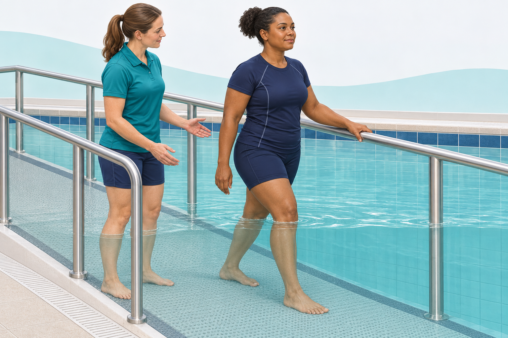
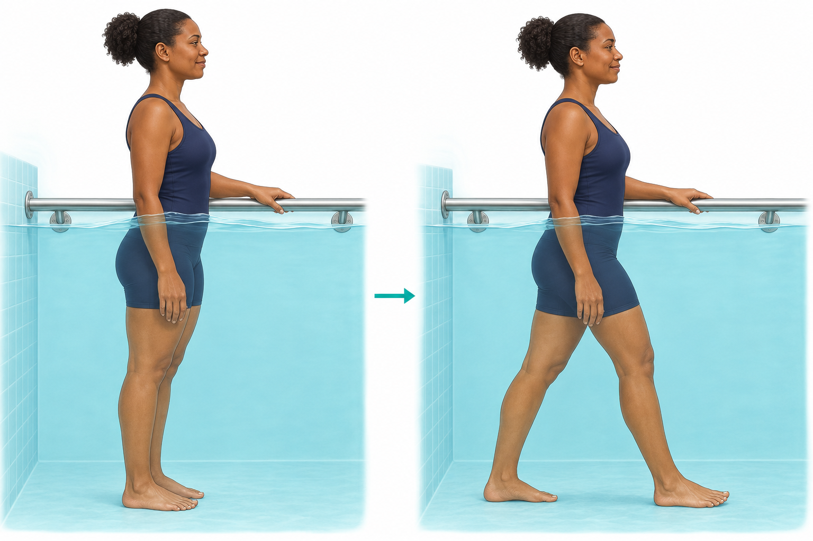
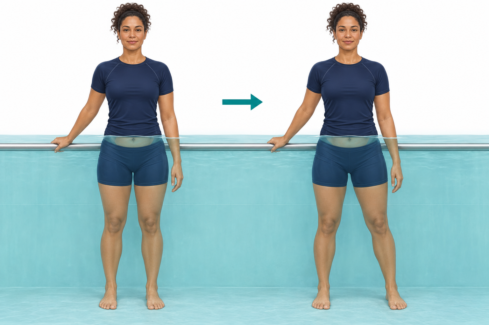
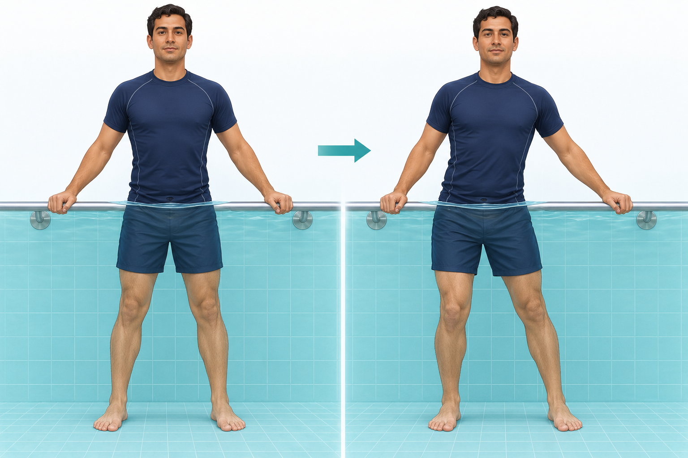
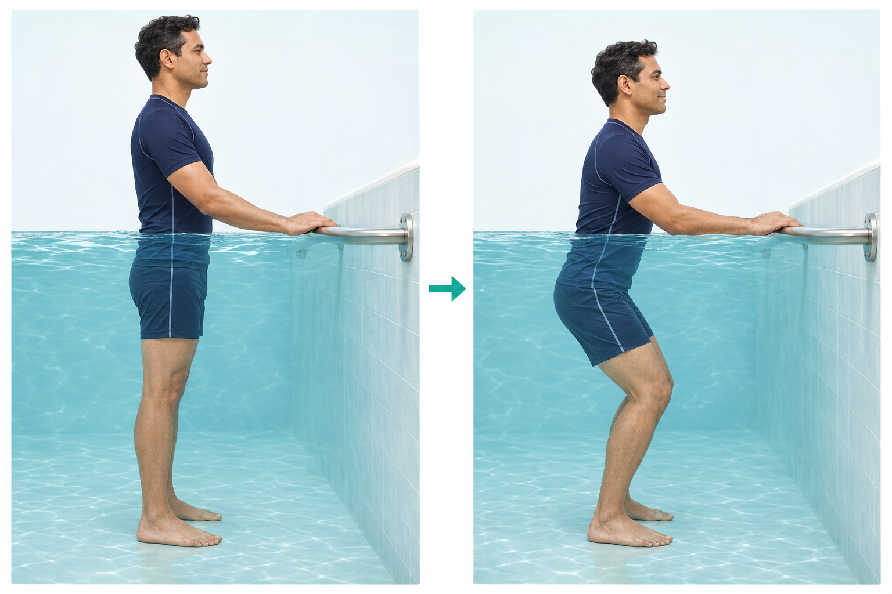
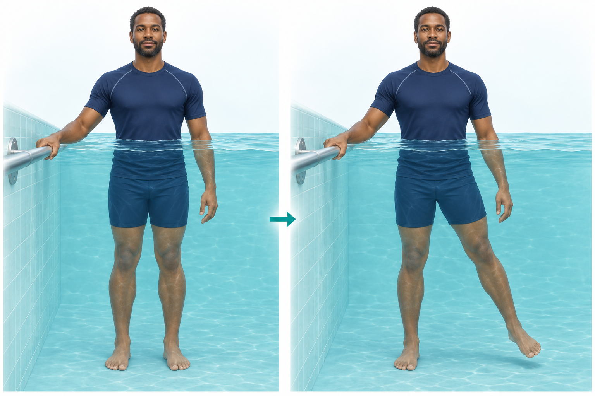
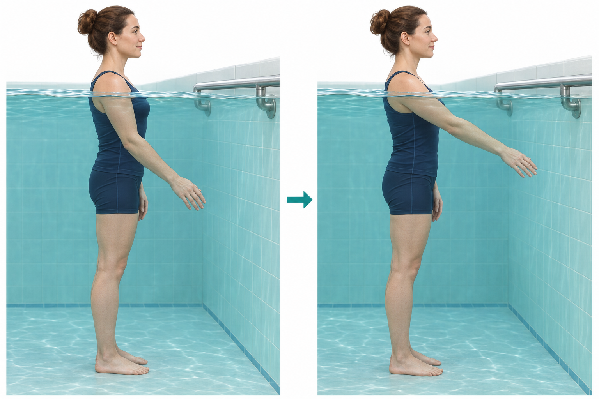
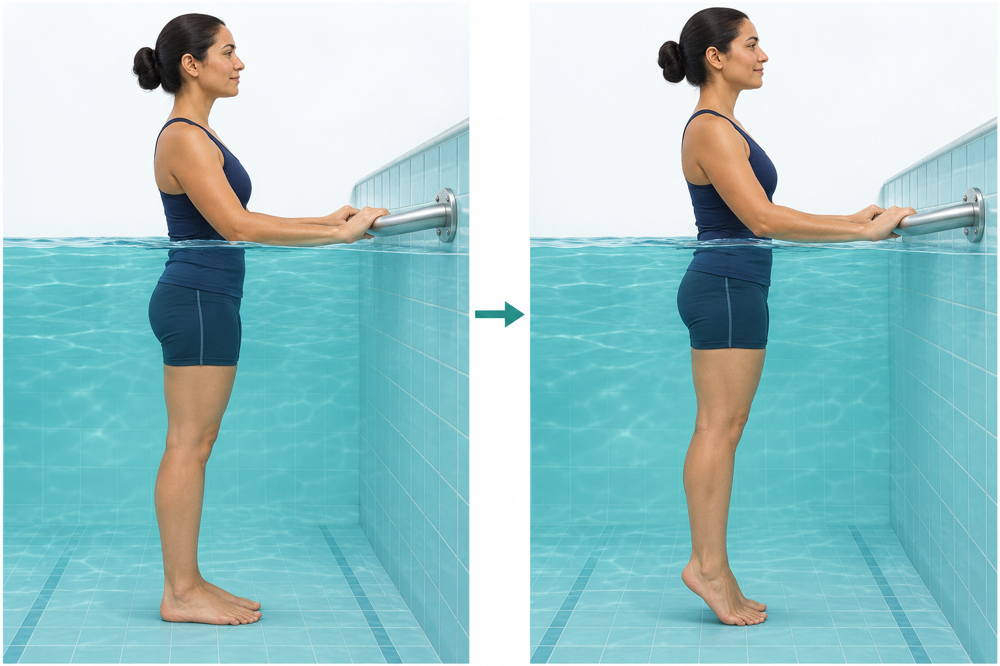
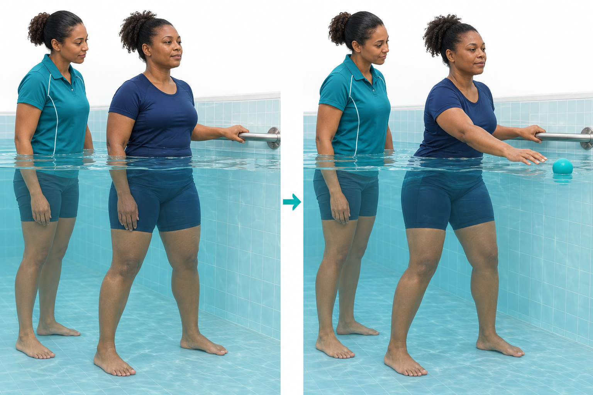

# Hidroterapia Ortopédica em Fisioterapia
## Formação teórico-prática em fisioterapia aquática

**Público:** estudantes em fase final da graduação, sob supervisão, e fisioterapeutas.
**Edição:** novembro de 2026 — versão ampliada e ilustrada.
**Formato:** apostila, estudos de caso, avaliação e roteiros para aulas práticas.

Esta é uma versão educacional para revisão técnico-científica antes de oferta comercial ou uso como protocolo institucional. Não constitui certificação profissional. A aplicação exige avaliação individual, habilitação, supervisão quando aplicável e observância das regras locais. Os vídeos ainda não foram gravados: este material inclui os roteiros, sem links fictícios.

# Apresentação e organização do curso

A fisioterapia aquática utiliza as propriedades da água como recursos para alcançar objetivos funcionais. Estar na piscina, por si só, não define um tratamento. Cada intervenção precisa ter uma hipótese clínica, uma dose, um critério de resposta e uma ponte com a vida fora da água.

Ao concluir o percurso, o aluno deverá explicar os efeitos da imersão; reconhecer situações que exigem adiamento ou encaminhamento; avaliar função e participação; selecionar e dosar exercícios; justificar progressões; documentar respostas; e integrar o atendimento aquático à reabilitação em solo.

**Carga horária sugerida: 80 horas**, a ser validada pela instituição: 32 horas de estudo e aulas teóricas, 16 horas de análise de demonstrações, 24 horas de laboratório presencial supervisionado e 8 horas de casos e avaliação. Assistir a vídeos não substitui prática supervisionada nem comprova competência para resgate aquático.

**Percurso:** estudar o módulo; responder às questões; assistir à demonstração correspondente quando disponível; executar em laboratório com supervisão; registrar decisões e discutir o caso. O docente deve revisar o material, conferir referências e adaptar as atividades à infraestrutura e ao perfil dos participantes.

**Avaliação sugerida:** prova teórica (30%), discussão de caso (30%) e estação prática supervisionada (40%). Exigir desempenho seguro em todos os itens críticos, independentemente da média. A instituição define critérios de aprovação e recuperação; essas proporções são propostas pedagógicas.

# Módulo 1 — Fundamentos, evidência e raciocínio clínico

## Competências do módulo
Ao final, o aluno deverá diferenciar modalidades aquáticas, justificar a escolha do ambiente, interpretar resultados de pesquisa e formular uma hipótese terapêutica relacionada à função. O objetivo é aprender a decidir, e não memorizar uma lista de exercícios por diagnóstico.

## O que caracteriza a fisioterapia aquática
Hidroterapia é uma expressão ampla. Neste curso, o foco é o exercício terapêutico em imersão e o uso criterioso de técnicas aquáticas em condições musculoesqueléticas. Natação, hidroginástica e reabilitação podem compartilhar movimentos, mas diferem quanto à avaliação, individualização, finalidade e responsabilidade profissional. Um exercício simples pode ser terapêutico quando integra um plano fundamentado; um movimento sofisticado não se torna tratamento apenas pelo nome do método.

A água modifica suporte, resistência, informação sensorial e demanda cardiorrespiratória. Essas mudanças podem facilitar uma tarefa e dificultar outra. O valor clínico depende da pessoa, da dose e do objetivo. Uma pessoa com dor ao apoiar pode participar melhor em imersão; outra pode enfrentar dificuldades respiratórias, insegurança ou barreiras de acesso que tornem o recurso inadequado [1].

## Do diagnóstico à atividade prioritária
O diagnóstico oferece informações sobre condição e restrições, mas não define sozinho a intervenção. Duas pessoas com osteoartrite podem ter limitações, comorbidades e metas diferentes. Avalie estruturas e funções, atividades, participação e contexto. Pergunte o que a pessoa precisa voltar a fazer, em quais condições e com qual nível de ajuda.

Formule uma hipótese em linguagem verificável: “a imersão permitirá praticar deslocamentos com menor limitação por dor, aumentando o tempo ativo; acompanharemos se isso se traduz em maior tolerância à caminhada em solo”. Essa hipótese indica a vantagem esperada, o mecanismo plausível e o resultado que a confirmará ou enfraquecerá. “Melhorar o paciente com hidroterapia” não informa como decidir.

## Evidência, benefício e limites de inferência
A revisão Cochrane sobre exercício aquático para osteoartrite de quadril e joelho encontrou benefícios de curto prazo em dor, incapacidade e qualidade de vida em comparação com ausência de exercício [2]. O resultado diz respeito às populações, intervenções e comparadores estudados. Não demonstra superioridade universal sobre exercícios em solo, benefício permanente ou eficácia em qualquer pós-operatório. Diretrizes de osteoartrite reforçam exercício e cuidado individualizado no conjunto do tratamento [3,4].

Ao ler um estudo, identifique população, critérios de exclusão, comparador, frequência, intensidade, duração, adesão e acompanhamento. Examine magnitude do efeito, incerteza e relevância para a atividade do paciente. Um resultado estatisticamente significativo pode representar uma mudança pequena; uma média de grupo não prevê a resposta individual. Intervenções com acompanhamento mais intenso podem diferir também em atenção, educação e adesão.

Diferencie plausibilidade de eficácia. Saber que o empuxo reduz o peso aparente explica uma possibilidade mecânica; não prova que determinado protocolo reduzirá incapacidade. Da mesma forma, melhora imediata da dor não equivale a cicatrização, regeneração de cartilagem ou correção estrutural. Benefícios precisam ser acompanhados por medidas pertinentes.

## Ciclo de decisão clínica
1. Identificar uma atividade prioritária e investigar segurança.
2. Medir a limitação e reconhecer fatores modificáveis.
3. Definir meta compartilhada e prazo de reavaliação.
4. Selecionar ambiente, tarefa e dose com uma justificativa explícita.
5. Monitorar execução, sintomas, recuperação e adesão.
6. Verificar transferência para solo e revisar a necessidade do recurso.

## Caso de aplicação
Uma pessoa evita caminhar por dor no joelho e pede apenas exercícios na piscina. Após avaliação, a água pode ser usada para ampliar participação, enquanto se mantém uma progressão terrestre compatível. Combine uma meta de caminhada, registre a condição inicial e revise resultados. Se apenas a execução aquática melhorar, investigue dose, transferência, fatores clínicos e barreiras contextuais; não presuma sucesso completo.

## Síntese e atividade
A escolha da água deve responder a uma necessidade concreta. **Atividade:** compare exercício aquático e terrestre para uma pessoa com osteoartrite. Descreva vantagem esperada, limitações, preferência do paciente e resultado que orientará continuidade. Cite qual conclusão das referências 2–4 pode apoiar sua decisão e qual permanece incerta.

# Módulo 2 — Física da água aplicada à prescrição

## Competências do módulo
Explicar empuxo, pressão, arrasto e momentos de força; prever como mudanças de posição e equipamento alteram uma tarefa; e usar esses princípios sem atribuir precisão clínica a cálculos simplificados. A referência 1 oferece uma base de leitura para integrar física e respostas à imersão.

## Densidade, deslocamento e empuxo
O empuxo corresponde ao peso do fluido deslocado: **E = ρ × g × V**, em que ρ é a densidade do fluido, g a aceleração da gravidade e V o volume deslocado. O resultado é uma força, expressa em newtons. O volume efetivamente submerso, e não apenas a altura do indivíduo, participa do cálculo. Composição corporal, ar pulmonar e acessórios influenciam a flutuação.

**Exemplo numérico exclusivamente didático:** um objeto rígido desloca 0,010 m³ em água com densidade aproximada de 1.000 kg/m³. Adotando g = 9,81 m/s², o empuxo é aproximadamente 98 N. O exemplo descreve um objeto e condições simplificadas; não determina a descarga de uma pessoa nem uma restrição de apoio pós-operatória.

A imersão pode reduzir a carga aparente nos membros inferiores. Entretanto, profundidade, movimento, apoio dos braços e composição corporal alteram a relação entre peso e forças de contato. A força muscular necessária a uma tarefa também permanece relevante. Não converta nível da água em um percentual fixo de descarga nem o use como comprovação de respeito a um limite cirúrgico.

<!-- diagram:leverage -->

## Equilíbrio e momentos de força
O centro de gravidade e o centro de empuxo representam pontos de aplicação resultantes de forças. Sua relação influencia tendência à rotação e equilíbrio. Mudar a posição dos braços ou acrescentar um flutuador pode deslocar essas relações e exigir ajustes posturais.

O momento depende da força e de sua distância perpendicular ao eixo de rotação: **M = F × d**. Em um exemplo estático simplificado, 20 N atuando perpendicularmente a 0,30 m produzem 6 N·m; a 0,60 m, produzem 12 N·m. Na pessoa em movimento, direção das forças e braços de momento mudam. O princípio ajuda a entender por que alongar uma alavanca pode aumentar a demanda, conforme a direção da força e a geometria, sem acrescentar equipamento.

Um flutuador na mão pode assistir a elevação e resistir à descida. O terapeuta deve observar tanto a ida quanto a volta. Fácil não significa sem carga, e assistência não significa segurança em qualquer amplitude.

## Pressão hidrostática
Em repouso, a pressão adicional devida à coluna de água cresce com a profundidade: **P = ρ × g × h**. A 0,50 m, nas condições simplificadas anteriores, corresponde a cerca de 4,9 kPa. Esse cálculo expressa pressão hidrostática adicional, não pressão arterial e nem uma meta terapêutica de compressão.

A pressão ao redor do corpo influencia deslocamento de fluidos e distribuição sanguínea. A imersão pode favorecer redução de edema em determinados contextos, mas edema de causa desconhecida exige investigação. Edema unilateral recente, dor na panturrilha ou suspeita de trombose não devem ser tratados como uma oportunidade de testar a compressão da água.

## Arrasto, área e velocidade
Uma aproximação é **F = ½ × ρ × Cd × A × v²**. A representa área frontal; Cd, um coeficiente relacionado à forma e ao fluxo; e v, velocidade relativa entre segmento e água. Se as demais variáveis permanecessem constantes, dobrar a velocidade quadruplicaria a força calculada. Em movimentos humanos, área, coeficiente e fluxo também mudam; a relação orienta o raciocínio, não fornece uma carga exata.

Abrir a mão, usar uma pá, aumentar a velocidade ou alongar a alavanca pode elevar a exigência. O arrasto se opõe ao movimento relativo; a água movimentada por outra pessoa também modifica a tarefa. Mudanças de direção exigem desaceleração e nova aceleração. Não traduza resistência aquática diretamente em quilogramas de musculação.

<!-- diagram:drag -->

## Turbulência e calor
Perturbações geradas pelo próprio paciente, colegas e jatos afetam estabilidade. Introduza desafios previsíveis antes de combinar turbulência, base estreita e retirada de apoio. A temperatura deve ser medida e relacionada à intensidade e à condição clínica. Água confortável para mobilização leve pode aumentar desconforto térmico durante exercício vigoroso. Convecção e circulação de água também influenciam a troca de calor.

## Aplicação e síntese
Escolha uma variável para progredir e observe a resposta antes de combinar mudanças. **Atividade:** explique como reduzir a exigência de uma abdução de quadril sem trocar de piscina. Depois descreva por que aumentar profundidade pode facilitar apoio e, simultaneamente, dificultar estabilidade ou respiração.

# Módulo 3 — Respostas fisiológicas à imersão

## Competências do módulo
Relacionar profundidade, temperatura e exercício às respostas cardiovasculares, respiratórias e térmicas; reconhecer intolerância; e escolher monitoramento coerente com a condição clínica. As respostas variam entre pessoas e não devem ser reduzidas a uma única regra [1].

## Sistema cardiovascular
A pressão externa e a imersão deslocam sangue da periferia em direção ao tórax, modificando pré-carga e volume sistólico. Frequência cardíaca e pressão arterial podem responder de modo diferente do exercício em solo, conforme profundidade, temperatura, intensidade, postura, medicação e doença associada. Uma frequência menor não comprova menor esforço global.

Pessoas com doença cardiovascular precisam de estabilidade clínica e limites individualizados. Insuficiência cardíaca descompensada, dor torácica e instabilidade hemodinâmica exigem adiamento e avaliação adequada. Não use ausência de sintomas no início como única evidência de estabilidade. Compare informação clínica, trajetória recente e capacidade funcional; solicite esclarecimentos à equipe quando necessários.

Na saída, o suporte e a distribuição de forças mudam. Levantar, subir uma escada e caminhar até o vestiário acrescenta demanda quando já existe fadiga. Planeje recuperação e assistência, observando tontura, fraqueza, palidez e dificuldade de manter postura. O atendimento inclui essa transição.

## Sistema respiratório
A pressão sobre o tórax e as alterações do volume sanguíneo podem aumentar o trabalho ventilatório. Imersão mais profunda pode ser difícil para pessoas suscetíveis, mesmo em repouso. Pergunte sobre dispneia, observe padrão respiratório e ajuste profundidade, apoio e intensidade.

Durante exercícios resistidos, incentive respiração contínua e evite apneia ou esforço de prender o ar. A capacidade de conversar pode oferecer uma informação complementar sobre a intensidade, mas não exclui risco clínico. Não use submersão da face como tarefa automática para alguém com medo ou baixa tolerância. Vias aéreas seguras são prioridade em todas as posições.

## Dor, movimento e controle neuromuscular
Suporte, conforto térmico e estímulos sensoriais podem facilitar movimento e reduzir temporariamente a dor. A tarefa também muda: menos carga aparente pode permitir maior amplitude, enquanto resistência e turbulência exigem controle. Não atribua toda melhora a um único mecanismo nem confunda alívio com recuperação estrutural.

Uma pessoa pode terminar a sessão sentindo-se melhor e, ainda assim, ter recebido uma dose excessiva. Avalie função e recuperação tardia. Em quadros de alta irritabilidade, registre quanto estímulo provoca sintomas e quanto tempo levam para reduzir. A resposta no dia seguinte ajuda a ajustar a próxima exposição.

## Termorregulação, hidratação e fadiga
A água troca calor com o corpo de forma diferente do ar. Temperatura, intensidade e duração influenciam o balanço térmico. Pessoas com alterações de sensibilidade, disautonomia, fragilidade ou determinados medicamentos podem perceber calor e esforço de modo diferente. Mantenha hidratação acessível e observe calafrios, calor excessivo, cefaleia, mal-estar e confusão.

Considere a carga total do atendimento: deslocamento, entrada, exercícios, banho e troca de roupa. Uma pessoa pode tolerar o bloco principal e não ter reserva para sair com segurança. Ajustar a sessão à capacidade global é parte da prescrição.

## Monitoramento integrado
Combine relato de esforço, sintomas, teste da fala e observação da respiração. Se usar Borg CR10, ensine seus pontos e mantenha a mesma escala; não misture com a escala de 6–20. Diferencie esforço geral, dor local e falta de ar. Medidas de frequência, pressão ou saturação devem ter indicação, equipamento apropriado e interpretação contextualizada. Dispositivos não preparados para imersão não devem ser expostos à água.

**Quadro de decisão:** resposta esperada e recuperação adequada permitem considerar manutenção ou progressão; esforço desproporcional pede redução e reavaliação; dor torácica, síncope, confusão ou dispneia súbita exigem interrupção e resposta ao possível evento agudo.

## Síntese e atividade
A mesma tarefa mecânica pode gerar respostas fisiológicas diferentes. **Atividade:** planeje como observar duas pessoas realizando caminhada aquática: uma com boa reserva funcional e outra com doença cardiorrespiratória estável e limites clínicos definidos. Descreva adaptações e sinais que mudariam sua conduta.

# Módulo 4 — Triagem, segurança e organização da piscina

## Competências do módulo
Decidir se é apropriado iniciar, adaptar ou adiar a sessão; organizar entrada e saída; reconhecer intercorrências; e integrar regras assistenciais, sanitárias e de privacidade. Segurança depende de pessoas, infraestrutura e processos, não apenas da habilidade de nadar. A referência 6 oferece princípios de segurança ambiental, complementados por normas locais atuais.

## Triagem inicial e atualização a cada atendimento
Investigue diagnóstico, evolução, cirurgias, restrições, comorbidades, medicações relevantes, quedas, tolerância ao esforço, integridade da pele, continência e capacidade de comunicação. Pergunte sobre medo da água, experiência prévia, apoio necessário e limitações de visão ou audição. Analise capacidade de entrar, permanecer e sair, inclusive em situação de fadiga.

A triagem do dia verifica mudanças: febre, sintomas respiratórios ou digestivos, lesões de pele, tontura, piora da dor, edema novo e alteração da orientação. Um cadastro antigo não substitui essa verificação. Explique como pedir pausa, qual assistência estará disponível e o que acontecerá se a sessão precisar ser interrompida.

## Decisões diante de risco
Adie diante de doença transmissível ativa relevante, diarreia, sangramento ativo, descompensação cardiovascular, dor torácica, dispneia inexplicada, suspeita de trombose ou deterioração aguda. Sinais de AVC, possível embolia ou outra emergência requerem acionamento imediato do serviço de emergência conforme o plano local. Não utilize a piscina para testar se sintomas importantes melhoram.

Feridas abertas, incisões recentes, infecções cutâneas, dispositivos e alterações de continência exigem avaliação específica e regras de controle de infecção. Um curativo impermeável não representa, sozinho, liberação. Confirme estado da ferida, orientação da equipe e protocolo da instalação. Uma autorização anterior precisa ser revista se surgirem novos achados.

Epilepsia, diabetes, gravidez e limitações cognitivas não recebem uma classificação automática neste curso. Considere estabilidade, gravidade, possibilidade de comunicação, supervisão e recursos. Um risco pode ser manejável em um serviço e incompatível com outro. Se faltarem informações determinantes, esclareça antes de iniciar a exposição.

## Infraestrutura e transferência
Inspecione piso, corrimãos, rampa, escada, elevador e rota até o vestiário. Verifique manutenção, funcionamento e compatibilidade com a pessoa. Se um equipamento de acesso estiver indisponível, não improvise içamento manual. Assistência física exige treinamento, organização de equipe e equipamento adequado; não puxe alguém pelo braço.

A restrição de carga vale também na escada, na borda e no vestiário. Planeje saída desde o início e considere necessidade de cadeira, ajuda adicional e pausas. Uma sessão clinicamente apropriada não compensa uma transferência insegura. Dimensione atendimento segundo complexidade, dependência e capacidade real de supervisão, sem adotar um número universal de pessoas por terapeuta.

## Emergência e comunicação da equipe
A instalação precisa definir responsabilidades, forma de acionamento, acesso do resgate, retirada segura e equipamentos. A equipe deve conhecer seu treinamento e limites, incluindo suporte básico de vida e uso de desfibrilador quando disponível e previsto. Demonstrações de exercícios não qualificam para resgate aquático.

Interrompa diante de dor torácica, dispneia desproporcional, síncope ou pré-síncope, confusão, nova alteração neurológica e perda de controle postural. Proteja vias aéreas, solicite ajuda e siga procedimentos para os quais a equipe está preparada. O ensino de resposta deve ocorrer por treinamento específico e simulação segura; não crie um risco real para demonstrar competência.

## Higiene, imagem e registro
Siga normas sanitárias de qualidade da água, manutenção e limpeza. A participação de profissionais não substitui os controles da instalação. Compartilhe com a equipe apenas informações necessárias, protegendo dados clínicos. Consentimento para atendimento não equivale a autorização de gravação, ensino ou divulgação.

Registre incidentes e quase incidentes, condutas e comunicação. A análise deve produzir melhorias, como revisar acesso ou reforçar treinamento, sem atribuir a falha apenas à pessoa que a percebeu.

## Checklist e atividade
**Antes de começar:** triagem atualizada; restrições compreendidas; acesso e saída viáveis; assistência suficiente; plano de emergência conhecido; comunicação combinada. **Atividade:** uma pessoa dependente chega e o elevador está quebrado. Justifique sua decisão e descreva uma alternativa segura de continuidade do cuidado.

# Módulo 5 — Avaliação funcional e metas

## Competências do módulo
Construir uma avaliação orientada à participação, selecionar medidas pertinentes e definir metas acompanháveis. A avaliação deve explicar a decisão terapêutica e detectar mudanças, evitando tanto uma coleta excessiva sem finalidade quanto um plano baseado apenas no diagnóstico.

## Entrevista e hipótese clínica
Pergunte o que a pessoa deixou de fazer, o que deseja recuperar e o que considera mais importante. Caracterize início, mecanismo, distribuição, intensidade e comportamento dos sintomas. Explore sono, trabalho, atividade física, tratamentos, expectativas e estratégias de enfrentamento. Investigue sinais de alerta conforme a região e encaminhe quando indicado.

Diferencie intensidade e significado clínico. A escala de dor acompanha uma dimensão da experiência, mas não localiza sozinha a fonte nem estabelece segurança de carga. Uma dor leve associada a nova perda de força pode exigir mais atenção que uma dor conhecida de maior intensidade sem mudança funcional. O contexto orienta a interpretação.

## Irritabilidade e trajetória
Descreva quanto estímulo provoca sintomas, qual a resposta e quanto demora a recuperar. Compare condição atual e evolução: melhora, estabilidade, flutuação ou deterioração. Pergunte sobre resposta no dia seguinte ao esforço e sobre atividades acumuladas na semana. Isso ajuda a escolher dose e intervalo sem pressupor que todos recuperam no mesmo ritmo.

## Exame em solo e em água
Selecione mobilidade, força, equilíbrio e tarefas de acordo com a hipótese e a segurança. Observe também dispositivos, assistência e estratégias. Não avalie todos os componentes possíveis se não houver relação com a decisão.

Na água, examine adaptação, respiração, apoio, marcha, flutuação e capacidade de seguir instruções. Registre profundidade e auxílio. Uma tarefa aquática não deve ser comparada diretamente a normas terrestres. O suporte pode revelar uma possibilidade de movimento; não comprova que a pessoa execute a mesma tarefa fora da piscina.

## Instrumentos e qualidade da medida
Exemplos incluem escala numérica de dor, escala funcional específica do paciente, teste de sentar e levantar e Timed Up and Go, conforme indicação. Medidas regionais podem incluir WOMAC, KOOS, HOOS, ODI ou QuickDASH. Verifique versão em português, instruções, população de validação e licença. Modificar perguntas ou procedimento e manter o nome de um instrumento validado compromete a interpretação.

Padronize ambiente, dispositivo, assistência e instruções. Registre se a pessoa mudou de medicamento, apresentou intercorrência ou recebeu ajuda diferente. Familiarização e variação diária podem alterar resultados. Uma pequena diferença não prova melhora: considere erro de medida, magnitude da mudança e relevância percebida, conforme instrumento e população.

## Metas compartilhadas e reavaliação
Uma meta descreve atividade, condição, critério e prazo. Exemplo: “completar o trajeto habitual até a padaria, de distância registrada, com no máximo uma pausa e o dispositivo usual, em quatro semanas”. O prazo é combinado e revisto conforme evolução, não uma promessa de resultado.

Planeje como verificar a meta: relato estruturado, registro domiciliar ou tarefa observada. Combine medidas de função, sintomas e participação. Se uma escala melhora e a atividade prioritária não, explore a diferença. Preferências e obstáculos, como transporte e custo, também devem entrar na análise de continuidade.

## Núcleo mínimo da ficha inicial
- Identificação necessária, contato de emergência e proteção de dados.
- Queixa, diagnóstico informado, cirurgias, datas e restrições confirmadas.
- Comorbidades, medicações relevantes e riscos da imersão.
- Pele, tolerância cardiorrespiratória, comunicação e transferências.
- Atividades prioritárias, medidas iniciais e hipóteses.
- Metas, dose inicial, assistência e data ou critério de reavaliação.

## Síntese e atividade
A medida precisa ajudar uma decisão. **Atividade:** formule uma avaliação inicial para uma pessoa que evita sair de casa por dificuldade de marcha. Escolha três informações indispensáveis, duas medidas e uma meta. Explique quais resultados mudariam sua prescrição, sem inventar valores normativos.

# Módulo 6 — Dosagem, progressão e estrutura da sessão

## Competências do módulo
Descrever uma dose reproduzível, ajustar a tarefa pela resposta e integrar a sessão ao plano de reabilitação. A intensidade não pode ser inferida somente pelo acessório, pela sensação de leveza ou pelo tempo dentro da piscina.

## Componentes da prescrição
Defina frequência, intensidade, tempo, tipo, volume e progressão. Acrescente profundidade, temperatura medida, postura, amplitude, velocidade, apoio, acessório, turbulência e pausas. “Três séries na piscina” não permite reproduzir nem avaliar a intervenção. Descreva o que foi feito e o que o paciente precisou fazer para conseguir executar.

Diferencie objetivos. Uma tarefa de mobilidade pode enfatizar exploração de amplitude autorizada; uma de força exige demanda e recuperação compatíveis; uma de equilíbrio desafia controle; uma de condicionamento organiza tempo ativo e esforço global. Um mesmo movimento pode servir a mais de um objetivo, mas o foco orienta a dose e a medida de resultado.

## Escolher um ponto de partida
Considere irritabilidade, capacidade, experiência aquática, restrições e custo total da sessão. Para uma primeira exposição, use tarefas familiares, blocos curtos e pausas suficientes para observar resposta. Não complete obrigatoriamente o horário reservado se a pessoa apresenta fadiga ou recuperação inadequada.

**Exemplo apenas didático:** um adulto estável, sem restrições específicas e já triado pode experimentar uma ou duas séries de seis a dez movimentos lentos em amplitude confortável, com apoio e esforço leve a moderado. Os números ilustram registro e decisão; não constituem receita validada. O profissional ajusta ou interrompe conforme objetivo, controle e resposta.

## Organização funcional da sessão
1. Triagem do dia, entrada planejada e adaptação.
2. Movimentos leves para observar respiração, apoio e sintomas.
3. Bloco principal dirigido à limitação prioritária.
4. Bloco complementar, se houver capacidade e justificativa.
5. Redução gradual da atividade, saída segura e registro.

O aquecimento não precisa ser uma sequência idêntica para todos. Uma caminhada pode ser adequada para alguém e inviável para outra pessoa. Da mesma forma, relaxamento não é uma obrigação nem substitui trabalho necessário à meta. Escolha elementos pelo propósito e pela resposta.

## Monitorar durante e depois
Combine previamente o que será acompanhado: dor conhecida, esforço, falta de ar, estabilidade, qualidade de movimento e recuperação. Uma faixa individualmente acordada de sintomas pode ajudar, mas nenhum número de dor garante segurança. Dor nova aguda, aumento progressivo, alteração neurológica, instabilidade ou derrame relevante exigem interrupção e reavaliação.

Registre estado antes, durante, após e no dia seguinte quando pertinente. Piora persistente de função, sono, edema ou tolerância às atividades sugere necessidade de rever dose e hipótese. Verifique também outras exposições, adesão e intercorrências. Não conclua automaticamente que toda piora é excesso de exercício, nem que toda dor faz parte da adaptação.

## Progressão, regressão e manutenção
Progrida quando a execução é segura, a recuperação aceitável e a mudança serve à meta. Aumente uma variável por vez: tempo, volume, velocidade, área frontal, amplitude autorizada ou complexidade. Retirar apoio modifica equilíbrio e não deve ser usado como progressão universal de força.

Para regredir, reduza velocidade, encurte alavanca, diminua área frontal, ofereça apoio, simplifique direção e amplie pausas. Ajuste a profundidade considerando descarga, estabilidade e respiração. Manter a dose pode ser uma escolha adequada enquanto se consolida execução e adesão. Progressão não precisa acontecer em todas as sessões.

## Transferência e encerramento do recurso
Introduza tarefas em solo conforme segurança e objetivo. A alta da piscina pode ocorrer antes da alta global. Se a água já não oferece uma vantagem necessária, planeje transição e manutenção. Se resultados forem insuficientes, investigue antes de aumentar automaticamente intensidade ou duração.

## Atividade de aplicação
Descreva a dose de uma caminhada aquática de modo que outro profissional compreenda a tarefa. Proponha uma única progressão e explique quais achados imediatos e tardios a autorizariam. Em seguida, descreva uma resposta que exigiria reduzir, suspender ou encaminhar.

# Módulo 7 — Métodos e técnicas: princípios e limites

## Competências do módulo
Reconhecer princípios de abordagens aquáticas, relacioná-los a objetivos e compreender a necessidade de formação específica. Este capítulo apresenta conceitos para análise; não equivale a certificação ou treinamento completo em métodos. A leitura histórica da referência 7 ajuda a discutir evidência, mas não sustenta superioridade universal de uma abordagem.

## Escolher uma abordagem pelo problema
Antes de selecionar um método, defina o que precisa mudar: adaptação, autonomia, controle postural, capacidade muscular, mobilidade ou participação. Pergunte se a técnica acrescenta algo relevante e se o profissional possui formação e recursos. Um exercício simples bem dosado pode atender melhor à meta que uma sequência complexa sem indicação clara.

Reconheça que nomes de métodos podem representar conjuntos variados de práticas. A justificativa clínica deve explicar tarefa, dose, assistência e resultado esperado, além do nome. Não atribua ao método benefícios estruturais ou fisiológicos que não tenham sido demonstrados para aquela população e aplicação.

## Halliwick: adaptação e controle no meio aquático
O conceito enfatiza adaptação mental, controle do equilíbrio e rotações, favorecendo independência no ambiente aquático. O processo envolve familiarização com propriedades da água, organização do corpo e participação ativa. Não se reduz a flutuar nem a reproduzir posições sem propósito.

Em ortopedia, princípios de adaptação e controle podem ajudar uma pessoa com receio a explorar transferência de peso ou ajustes de tronco. A seleção depende de comunicação, conforto e capacidade de manter cabeça e vias aéreas seguras. Rotação inesperada, retirada súbita de apoio e exposição forçada podem aumentar medo e risco.

O terapeuta combina o objetivo, explica o que acontecerá e observa a resposta. Autonomia não significa abandonar supervisão. Uma progressão adequada aumenta participação e controle dentro de condições seguras, respeitando restrições musculoesqueléticas e capacidade cardiorrespiratória.

## Bad Ragaz Ring Method: suporte e trabalho neuromuscular
O método utiliza suporte por flutuadores, contato do terapeuta e padrões de movimento para trabalho neuromuscular. Relação entre posição, ponto de contato, resistência e movimento da água altera a tarefa. Posicionamento adequado deve considerar conforto, respiração, restrições e capacidade de colaborar.

Em posições horizontais, suporte de cabeça e organização dos segmentos são importantes. Um colar ou outro acessório não garante proteção das vias aéreas em todas as condições. A posição supina pode ser mal tolerada por algumas pessoas; não a mantenha apenas para completar uma técnica.

A resistência pode depender tanto do movimento do paciente quanto da ação do terapeuta e do meio. É preciso dosar, comunicar e ajustar sem tração dolorosa nem posição proibida. O manejo de contatos, estabilização e flutuadores exige laboratório supervisionado e formação específica. Assistir a uma demonstração não comprova competência para aplicar a técnica em pacientes.

## Relaxamento e técnicas passivas
Conforto e redução transitória de sintomas podem facilitar participação. Técnicas passivas devem ter propósito claro e resposta acompanhada. Não prometa realinhamento estrutural, regeneração ou correção definitiva a partir de sensações imediatas. Quando a meta envolve atividade, integre estratégias que construam participação e capacidade, em vez de depender exclusivamente de condução passiva.

Respeite consentimento, preferências e possibilidade de interromper. Algumas pessoas se sentem vulneráveis ao perder contato com o fundo ou ao serem conduzidas em posição horizontal. A comunicação é parte da técnica, não um detalhe acrescentado ao movimento.

## Integração com o plano e documentação
Registre abordagem, posição, suporte, contatos, movimentos, dose, resposta e justificativa. Não escreva apenas “realizado método” se isso impede compreender a intervenção. Observe se o ganho alcançado facilita uma atividade relevante e se persiste além do efeito imediato.

**Exemplo:** após uma estratégia de adaptação, a pessoa consegue praticar deslocamento com menor receio. O resultado útil é a participação segura e sua evolução; isso não prova que o método seja superior a todas as alternativas.

## Síntese e atividade
Métodos são recursos dentro de um raciocínio clínico. **Atividade:** escolha uma meta e compare uma técnica específica com exercício aquático simples. Discuta formação necessária, assistência, risco, preferência e medida de resultado. Identifique quais habilidades ainda exigiriam treinamento prático antes da aplicação.

# Da física ao resultado clínico — por que pode funcionar

<!-- diagram:mechanisms -->

## O encadeamento que justifica uma intervenção
Uma explicação profissional precisa conectar seis elementos: **propriedade física, efeito no organismo, tarefa possível, dose de prática, adaptação esperada e resultado relevante**. Entre cada elemento existe uma hipótese que precisa ser verificada. Saber que a água exerce empuxo não demonstra, sozinho, que um programa melhora a marcha; também é necessário que o paciente pratique uma tarefa apropriada, com dose suficiente, tolerância e transferência para sua rotina.

Considere uma pessoa que evita caminhar por dor no joelho. A imersão pode reduzir parte da demanda de sustentação, permitindo mais tempo de caminhada tolerável. A repetição de sessões pode contribuir para aumentar tolerância ao esforço e confiança. A hipótese só ganha utilidade clínica se caminhar fora da piscina também ficar mais viável. A medida final deve acompanhar essa atividade, além do desempenho aquático. Os fundamentos físicos e fisiológicos são descritos na referência [1]; os resultados clínicos dependem de estudos em populações e programas específicos, como em [2].

## 1. Descarga: facilitar participação sem eliminar forças
O peso atua para baixo e o empuxo para cima. Em uma situação estática simplificada, a força necessária para sustentar o corpo pode diminuir quando o volume submerso aumenta. É uma explicação mecânica para a possibilidade de realizar apoio com menor carga aparente. Na situação real, posição, apoio dos braços, flutuação, movimento e aceleração alteram as forças. Não há uma correspondência individual exata entre altura da água e percentual de carga [1].

Além disso, menor força externa de apoio não significa ausência de força articular. Músculos continuam produzindo tensão para movimentar e estabilizar; o arrasto pode elevar essa exigência. Portanto, um agachamento rápido na água não é automaticamente menos exigente para todas as estruturas que um movimento lento em solo. A pergunta adequada é qual componente da demanda está sendo reduzido e qual está sendo acrescentado.

A utilidade provável é abrir uma oportunidade de prática quando o apoio terrestre limita participação. Em restrições cirúrgicas, essa justificativa não comprova que um limite de carga foi obedecido. A decisão depende da autorização específica e de uma forma apropriada de controlar a tarefa.

## 2. Do movimento facilitado à capacidade adquirida
Uma mudança imediata ocorre quando o ambiente permite executar algo que antes não era possível: caminhar com menos receio, elevar o braço com suporte ou explorar uma amplitude tolerável. Essa é uma **mudança das condições da tarefa**. Ela pode ser valiosa, mas ainda não representa ganho de força, cicatrização ou consolidação.

Adaptações ao treinamento exigem exposições repetidas, recuperação e progressão compatíveis com o objetivo. A quantidade de prática realizada, sua intensidade e a continuidade do programa importam. Recomendações de exercício e autogestão integram o cuidado da osteoartrite [3,4]; recomendações populacionais de atividade física fornecem contexto geral, sem definir a dose terapêutica de um indivíduo [5].

Uma interpretação útil é separar registros: “hoje conseguiu caminhar na água” descreve desempenho imediato; “nas últimas semanas ampliou o percurso terrestre” descreve uma mudança funcional. Não use o primeiro resultado para anunciar o segundo. Quando o desempenho melhora apenas dentro da água, investigue dose, barreiras em solo, especificidade da tarefa e a pertinência de manter o recurso.

## 3. Resistência: a água pode facilitar e desafiar simultaneamente
O arrasto se opõe ao movimento **relativo entre corpo e água**. Sua intensidade depende, entre outros fatores, da velocidade, da área frontal e da forma do segmento. Em uma aproximação física, aumentar a velocidade pode elevar a resistência de maneira não linear; o corpo humano e o fluxo ao redor dele tornam inadequado transformar essa relação em uma carga clínica exata [1].

O empuxo é outra força: sua direção é ascendente e não muda simplesmente porque o segmento mudou de direção. Ao elevar um braço submerso, ele pode ajudar o movimento; ao baixá-lo, pode criar resistência. O arrasto, por sua vez, se opõe ao deslocamento relativo em cada direção. O movimento observado resulta da combinação dessas forças com gravidade, ação muscular e estabilização.

O tipo de contração não pode ser deduzido apenas pelo nome do exercício. Na descida controlada de um segmento, um músculo pode frear uma força externa ou outro grupo pode produzir o movimento; acessórios e velocidade alteram essa relação. Para ensinar, identifique direção do movimento, forças externas e articulação analisada. Não rotule toda ida como concêntrica e toda volta como excêntrica.

## 4. Alavanca, torque e escolha do acessório
Uma força aplicada distante do eixo articular pode produzir maior momento quando aumenta sua distância perpendicular ao eixo. Estender o cotovelo durante um movimento de ombro modifica a geometria, a área exposta e as exigências de controle. Não muda apenas a aparência do exercício.

Uma pá pode ampliar o arrasto, enquanto um flutuador acrescenta empuxo e altera momentos. Ambos podem dificultar uma tarefa, mas por razões diferentes. Começar sem acessório ajuda a observar se ele realmente acrescenta um estímulo necessário. Se o paciente perde equilíbrio ou prende a respiração, a nova demanda pode exceder o objetivo pretendido.

A adaptação esperada depende do estímulo obtido: resistência suficiente, repetida e progressiva pode contribuir para a capacidade muscular; uma tarefa extremamente leve pode servir sobretudo à mobilidade e familiarização. Isso é raciocínio de prescrição, não comprovação de que um acessório específico produz mais hipertrofia ou melhores resultados clínicos. Meça esforço, execução, recuperação e a função que o exercício pretende apoiar.

## 5. Pressão, fluidos e edema: mecanismo não é diagnóstico
A pressão hidrostática cresce com a profundidade. A imersão aplica pressão externa aos tecidos e modifica a distribuição de fluidos e sangue. Esse mecanismo ajuda a compreender mudanças circulatórias e a possibilidade de alterações temporárias no volume periférico [1]. Movimento muscular e posição também participam da resposta.

Entretanto, “edema” descreve um sinal com causas diferentes. Uma mudança visual após imersão não identifica sua origem nem demonstra resolução do problema. Edema pós-operatório esperado, insuficiência venosa, infecção, trombose e descompensação sistêmica não recebem a mesma conduta. A existência de um mecanismo físico favorável não autoriza tratar uma causa ainda não avaliada.

Para acompanhar um caso apropriado, use medidas padronizadas, condições semelhantes e registro de sintomas e função. Mudanças de posição, horário ou método podem alterar a comparação. Edema unilateral recente, dor ou sinais sistêmicos exigem investigação; a piscina não deve ser usada como teste para verificar se melhora. A interpretação clínica vem antes da escolha do recurso.

## 6. Temperatura, conforto e modulação da dor
A água troca calor com o corpo e a temperatura interfere na experiência e na resposta fisiológica. Um ambiente confortável pode facilitar relaxamento, disposição e movimento; exercício mais intenso produz calor e pode tornar a mesma água desconfortável. Duração, composição corporal, condição clínica e medicações modificam tolerância [1].

A dor também pode variar com atenção, expectativas, segurança percebida e experiência prévia. Esses fatores não tornam a melhora falsa; mostram que ela não pode ser atribuída integralmente a uma propriedade isolada. Uma sessão combina ambiente, movimento, relação terapêutica e contexto. Distinguir suas contribuições exige desenhos de pesquisa adequados, não apenas observação antes e depois.

A analgesia imediata pode permitir uma exposição útil. Contudo, menos dor durante a sessão não comprova maior tolerância dos tecidos a uma carga arbitrária. Verifique a resposta posterior e a capacidade funcional. A proposta é usar o conforto para construir participação, sem apresentar aquecimento como regeneração de cartilagem ou como substituto da progressão de exercício.

## 7. Cardiovascular e respiração: benefício possível, demanda real
A redistribuição sanguínea na imersão modifica o retorno venoso e a demanda cardiovascular. A pressão sobre o tórax e alterações dos volumes corporais também influenciam a mecânica respiratória. Esses efeitos explicam por que a piscina não deve ser considerada um ambiente universalmente leve, mesmo quando o apoio dos membros inferiores diminui [1].

A intensidade do exercício, a profundidade, a temperatura e as condições clínicas interagem. A frequência cardíaca pode diferir da observada em solo, e medicamentos podem alterar sua resposta. Esforço percebido, fala e sintomas acrescentam informações, mas nenhum deles exclui isoladamente risco cardiovascular ou respiratório.

O efeito desejado de um treino de condicionamento é ampliar capacidade com exposições toleráveis e progressivas. O caminho exige triagem, monitoramento e limites individualizados. Em pessoas com estabilidade incerta ou sintomas novos, não se deve procurar uma profundidade que pareça confortável para contornar a necessidade de avaliação. A saída da piscina também faz parte da dose e da observação clínica.

## 8. Controle motor, segurança percebida e transferência
O suporte e a resistência da água podem modificar a velocidade dos movimentos e o modo como a pessoa enfrenta uma tarefa. A oportunidade de praticar com menor medo pode favorecer exploração e repetição. Turbulência e deslocamentos acrescentam perturbações, mas não são sinônimos de melhor treino: precisam corresponder ao objetivo e à capacidade atual.

Aprender uma tarefa envolve informação sensorial, atenção, tentativa, feedback e repetição. O terapeuta pode começar com instruções claras e apoio, depois reduzir ajuda quando houver controle. A quantidade de assistência deve ser suficiente para segurança, sem executar toda a tarefa pelo paciente quando a participação ativa é possível.

A transferência para solo não é automática, pois forças, referências sensoriais e demandas mudam. Esta explicação é uma aplicação de princípios de aprendizagem e especificidade, não uma demonstração de eficácia de qualquer sequência aquática. Para testar a hipótese, escolha uma atividade terrestre relevante e reavalie em condições semelhantes. Se ela não muda, revise o programa e suas barreiras.

## 9. O que a evidência permite concluir
Na revisão de exercícios aquáticos para osteoartrite de joelho e quadril, os efeitos de curto prazo em comparação com ausência de exercício precisam ser interpretados junto da magnitude, do comparador e da população [2]. Isso não confirma todos os mecanismos propostos, não estabelece superioridade para qualquer alternativa terrestre e não sustenta promessas para toda condição ortopédica.

As diretrizes de osteoartrite apoiam exercício individualizado dentro de um cuidado mais amplo [3,4]. A referência [1] apresenta fundamentos fisiológicos e aplicações; a referência [7] é uma leitura histórica, que não substitui atualização. Normas de segurança de piscina abordam riscos ambientais [6], sem funcionar como protocolo para cada diagnóstico.

Uma explicação honesta informa ao aluno quando há um mecanismo bem descrito, uma inferência razoável de prescrição ou um resultado clínico demonstrado. Usar termos diferentes para essas situações não enfraquece o curso: ensina a decidir sem transformar plausibilidade em certeza.

## Laboratório 1 — Velocidade, área frontal e esforço
**Participantes e preparação:** demonstradores adultos saudáveis, triados, supervisionados e confortáveis na água, com apoio estável disponível. Não realizar em pacientes com restrições nem buscar esforço máximo.

**Previsão:** mantendo amplitude e apoio semelhantes, mover o antebraço um pouco mais rápido ou aumentar sua área frontal tende a elevar a resistência percebida. O tamanho da diferença é uma observação individual, não uma medida de força em newtons.

**Procedimento:** comparar dois blocos breves e confortáveis, primeiro mudando somente velocidade; após recuperação, comparar a orientação da mão, mantendo a cadência aproximada. Registrar número de movimentos, duração, esforço relatado e perda de controle. Interromper com desconforto ou insegurança.

**Discussão:** quais variáveis não ficaram constantes? A água já estava em movimento? O participante compensou com o tronco? Explicar por que uma previsão física não gera uma equivalência com quilogramas de musculação.

## Laboratório 2 — Direção do empuxo e braço de alavanca
**Preparação:** demonstrador saudável e supervisionado, em posição estável, com ombro confortável. Usar um flutuador pequeno apenas se houver controle e possibilidade de soltá-lo sem risco.

**Previsão:** o acessório tende a subir; baixar e elevar lentamente não têm a mesma combinação de forças. Alterar a posição do cotovelo modifica o momento e a área exposta.

**Procedimento:** observar primeiro a tendência ascendente do acessório sem tracionar o membro; depois executar movimentos pequenos e confortáveis, com cotovelo mais flexionado e menos flexionado. Registrar direção, amplitude aproximada, esforço e necessidade de estabilização. Não forçar amplitude nem comparar com um pós-operatório.

**Discussão:** separar empuxo e arrasto e identificar qual força se opõe a cada fase. O esforço percebido não identifica sozinho qual músculo contraiu nem comprova um estímulo específico de fortalecimento.

## Laboratório 3 — Desempenho aquático e tarefa em solo
**Preparação:** demonstrador saudável, supervisionado, com rota segura e recuperação após a saída. Selecionar uma caminhada curta em condições padronizadas e sem teste de limite.

**Previsão:** tempo, número de passos e esforço podem diferir entre os ambientes, sem que um resultado seja necessariamente melhor. O objetivo é reconhecer a especificidade da tarefa.

**Procedimento:** registrar percurso, duração, passos, apoio e esforço em solo e na piscina; documentar profundidade e pausas. Não calcular velocidade equivalente entre meios nem interpretar uma única comparação como efeito terapêutico. Considerar que a ordem pode produzir aprendizado ou fadiga.

**Discussão:** quais fatores explicam as diferenças? Qual medida acompanharia uma meta de caminhar no bairro? Encerrar com uma hipótese de tratamento e um critério de reavaliação, distinguindo observação de laboratório, mecanismo plausível e eficácia clínica.

# Módulo 8 — Coluna vertebral

## Competências e pergunta clínica
Ao concluir este módulo, o aluno deve distinguir apresentações que pedem encaminhamento, explicar como a água modifica a demanda do movimento e construir uma progressão ligada a uma atividade. A pergunta orientadora é: a pessoa precisa de menos demanda inicial, mais confiança, maior tolerância ou um estímulo físico diferente? O diagnóstico isolado não responde.

## Anatomia funcional: por que o tronco trabalha na água
O movimento resulta da interação entre coluna, pelve, quadris, caixa torácica e membros. Músculos como eretores da coluna, multífidos, abdominais e glúteos contribuem de maneira variável para produzir e controlar forças. Não existe um único músculo responsável pela estabilidade nem uma postura obrigatória para todas as tarefas.

Ao caminhar ou mover os braços na água, o arrasto aplica forças que precisam ser transmitidas pelo tronco. Um alcance mais distante pode aumentar o braço de momento, conforme a direção das forças; maior velocidade relativa tende a ampliar o arrasto. O controle depende também da base de apoio, da profundidade e da antecipação. Portanto, um movimento aparentemente simples dos braços pode constituir uma tarefa de tronco, mesmo sem flexões repetidas da coluna.

O empuxo reduz parte da demanda gravitacional conforme a posição. Isso pode facilitar exposição ao movimento, mas a atividade muscular e as forças articulares continuam presentes. Flutuação não comprova descompressão discal, reposicionamento vertebral ou correção de hérnia. Os mecanismos gerais de imersão descritos em [1] ajudam a formular hipóteses; não demonstram um efeito estrutural específico em cada paciente.

## Avaliação que modifica a decisão
Diferencie dor inespecífica, sintomas irradiados e alteração neurológica. Investigue evolução, padrão dos sintomas, trauma, sinais sistêmicos e fatores relevantes da história. Mudança recente de controle urinário ou intestinal, anestesia em sela e déficit neurológico progressivo exigem avaliação urgente. A piscina não é o lugar para testar se esses sintomas desaparecem.

Na dor persistente, avalie sono, atividade, medo, expectativas e trabalho. Esses fatores ajudam a compreender limitações, sem invalidar a dor. Pergunte qual tarefa é importante: caminhar, vestir-se, carregar compras ou brincar com uma criança. Uma medida funcional específica e, quando indicado, instrumento validado de incapacidade permitem acompanhar mais que intensidade de dor.

## Seleção, dose e ajuste
Comece por tarefas que respondam à barreira identificada. Caminhada em blocos pode trabalhar tolerância; transferência de peso permite explorar apoio; alcances graduais desafiam controle e confiança. Movimentos de flexão, extensão ou rotação não são obrigatoriamente proibidos ou obrigatoriamente necessários: a escolha depende do quadro, das restrições e da resposta.

Descreva duração, apoio, profundidade, velocidade e esforço. Como exercício didático, o aluno pode comparar um alcance curto e lento com outro mais longo, mantendo as demais variáveis. O objetivo é perceber a mudança de demanda, não perseguir amplitude máxima. Evite apneia e rigidez excessiva impostas como condição de segurança.

Progrida uma variável quando houver execução e recuperação adequadas. Regresse com menos velocidade, alcance, tempo ou mais apoio. Sintomas novos, progressão da irradiação, déficit ou perda funcional pedem reavaliação. Uma sensação local transitória não deve ser interpretada automaticamente como lesão, mas tampouco ignorada sem contexto.

## Caso de raciocínio e transferência
Uma pessoa com lombalgia persistente evita alcançar objetos e quer voltar a cuidar do filho. Após triagem, o terapeuta combina alcances pequenos com apoio e explicação não ameaçadora. A hipótese é que uma demanda tolerável facilite prática e confiança. A melhora na piscina será insuficiente se a pessoa continuar incapaz de realizar a tarefa em solo; introduza exposição terrestre graduada e reavalie a atividade prioritária.

**Síntese:** a água oferece condições diferentes para praticar movimento; não elimina a necessidade de raciocínio diferencial, dose e transferência. **Questão aplicada:** que achado faria você interromper um bloco de caminhada e mudar sua hipótese clínica?

# Módulo 9 — Ombro e demais membros superiores

## Competências e objetivo funcional
O aluno deverá explicar assistência e resistência do empuxo, reconhecer como alavancas alteram a exigência e escolher tarefas para alcançar, vestir-se ou manipular objetos. O objetivo não é executar o maior repertório possível, mas selecionar movimentos compatíveis com a condição do tecido e a atividade desejada.

## Anatomia funcional e mecanismo da tarefa
A elevação do braço envolve articulações glenoumeral, escapulotorácica, acromioclavicular e esternoclavicular, além da participação torácica. Deltoide, manguito rotador, serrátil anterior e trapézio contribuem de formas complementares. Não se deve atribuir toda dor a uma única estrutura ou considerar qualquer movimento da escápula um erro.

A água pode sustentar parte do peso do membro e facilitar sua elevação lenta. Ao baixar o braço contra o empuxo, a direção da demanda muda. Um flutuador distal aumenta a força de empuxo e seu momento sobre as articulações; pode facilitar uma fase e dificultar outra. Com velocidade maior, o arrasto também aumenta, independentemente de o paciente relatar sensação de leveza.

Flexionar o cotovelo encurta a alavanca em muitas tarefas, modificando o momento no ombro. Abrir a mão ou acrescentar pá muda a área frontal. Essas relações explicam por que dois exercícios com a mesma amplitude podem ter exigências diferentes. Os princípios físicos de [1] sustentam esse raciocínio, mas não definem uma dose universal para cada diagnóstico.

## Avaliação e diferenciação
Caracterize início, trauma, irritabilidade, sono, atividade e limitações. Investigue perda de força ou função após trauma, alterações neurológicas e sintomas sistêmicos conforme a apresentação. Sintomas do membro superior podem ter componente cervical ou origem não musculoesquelética; dor torácica ou mal-estar associado exigem conduta apropriada, não um teste de ombro na piscina.

Após cirurgia, confirme tecido reparado, condição da ferida, amplitude, movimento ativo permitido e momento de introdução de resistência. Uma autorização genérica pode não responder a essas perguntas. Ausência de dor não comprova integridade do reparo nem liberação para progredir.

## Construção de uma sequência
Use apoio corporal seguro e posição confortável. Inicie movimentos lentos dentro da amplitude autorizada, com controle na ida e na volta. A altura da água deve permitir a tarefa sem comprometer respiração, equilíbrio ou acesso. Não use flutuação para empurrar o braço ao fim de amplitude.

Para progredir, escolha volume, amplitude permitida, alavanca ou resistência, conforme a finalidade. Evite mudar todas simultaneamente. Atravessar a superfície modifica rapidamente o suporte e a resistência; esse trecho pede controle e não deve ser acrescentado sem análise. Na regressão, reduza velocidade, encurte a alavanca, ofereça assistência e amplie pausas.

Cotovelo, punho e mão podem trabalhar mobilidade, prono-supinação e tarefas de manipulação. Respeite restrições de fratura, reparo tendíneo e lesão ligamentar. A redução visual de edema não confirma resolução de sua causa e não autoriza aumentar a carga automaticamente.

## Controle da volta e tipo de contração
A direção do deslocamento, sozinha, não permite classificar a contração de todos os músculos. Durante uma tarefa assistida pelo empuxo, alguns músculos produzem movimento, outros controlam a velocidade e outros estabilizam segmentos. A resistência varia com direção e velocidade. Não descreva toda atividade aquática como exclusivamente concêntrica ou exclusivamente excêntrica; a análise exige conhecer forças, posição e ação muscular naquele momento.

## Caso de raciocínio e transferência
Uma pessoa com dor ao vestir camiseta tolera elevação lenta assistida, mas sente piora após usar uma pá. A hipótese é que a área frontal elevou demanda além da capacidade atual; confirme a relação temporal e examine outros fatores. Retire a pá, revise dose e acompanhe recuperação. Teste a tarefa de vestir-se em solo: uma amplitude aquática maior só é útil se contribuir para função.

**Síntese:** suporte não significa ausência de força. **Questão aplicada:** descreva como o mesmo flutuador pode assistir um movimento e aumentar a exigência na volta, sem atribuir ao acessório um peso terrestre fixo.

# Módulo 10 — Quadril, pelve e marcha

## Competências e finalidade
O aluno deve relacionar controle do quadril, demanda de apoio e marcha, escolher exercícios por uma limitação demonstrada e reconhecer particularidades após artroplastia. A meta pode ser caminhar, subir um degrau ou levantar; não se resume a aumentar força isolada em uma direção.

## Anatomia funcional e por que a tarefa muda
Glúteos, adutores, flexores e rotadores participam do movimento e do controle entre pelve e fêmur. Na fase de apoio da marcha, forças externas e musculares precisam ser equilibradas. Uma inclinação do tronco pode refletir dor, estratégia para reduzir demanda, fraqueza ou outras condições; observá-la não basta para fechar diagnóstico.

A imersão pode diminuir parte da carga aparente e permitir mais prática. Entretanto, os músculos ainda precisam estabilizar e deslocar o corpo. A água resiste ao avanço da perna, e uma velocidade maior pode elevar a demanda mesmo com descarga de peso. O membro de apoio e o membro em movimento enfrentam exigências distintas.

Na abdução em pé, a perna móvel enfrenta arrasto e o apoio precisa controlar o equilíbrio. Uma alavanca mais longa ou acessório distal pode aumentar os momentos externos, conforme posição, direção das forças e volume submerso; elevar muito a perna pode aumentar movimento do tronco sem acrescentar estímulo útil ao objetivo. O exercício deve ser descrito e observado como uma tarefa global.

## Avaliação e escolha da intervenção
Osteoartrite, dor lateral do quadril, sequelas de trauma e condições lombares podem produzir limitações diferentes. Caracterize dor, mobilidade, apoio, marcha e atividades. Investigue trauma com incapacidade de sustentar carga, deterioração aguda e sinais sistêmicos quando presentes. Dor na região lateral ou inguinal, isoladamente, não confirma a estrutura responsável.

A evidência de exercício aquático para osteoartrite de quadril e joelho [2] permite discutir benefícios de curto prazo em populações estudadas. Diretrizes de osteoartrite [3,4] apoiam exercício e cuidado individualizado. Isso não demonstra que a água é superior em qualquer situação ou que corrigirá mudanças estruturais.

## Artroplastia e segurança do acesso
Confirme liberação de imersão, cicatrização e orientações específicas de movimento e apoio. As precauções variam com abordagem, procedimento, intercorrências e decisão assistencial. Um conjunto único de restrições ou datas não atende a todos.

O acesso pode ser mais limitante que o exercício. Rampa, elevador, assento e escada precisam ser compatíveis com capacidade e restrições. Se a transferência exige movimentos não autorizados ou assistência indisponível, escolha outro recurso ou local. A segurança dentro da água não compensa uma saída inadequada.

## Dose, progressão e transferência
Selecione caminhada, passos laterais ou exercício de quadril conforme a hipótese. Use apoio quando necessário; registre direção, velocidade, amplitude, volume e recuperação. Aumentar distância, retirar apoio e acrescentar equipamento ao mesmo tempo dificulta interpretar a resposta.

Progrida pela execução, esforço e resposta tardia. Regresse com base mais estável, amplitude menor, blocos curtos e assistência. Avalie a marcha terrestre com dispositivo quando indicado. O bom desempenho aquático pode depender do empuxo e não provar independência em solo.

## Caso de raciocínio
Uma pessoa com osteoartrite consegue caminhar mais na água, mas permanece limitada para chegar ao ponto de ônibus. O recurso está facilitando exposição, porém a transferência ainda não aconteceu. Mantenha a dose útil e acrescente progressão terrestre tolerável; investigue distância, terreno, confiança e fadiga. Reavalie a meta real antes de apenas aumentar voltas na piscina.

**Síntese:** controle muscular e tolerância ao apoio devem ser testados no contexto funcional. **Questão aplicada:** qual variável você mudaria primeiro se a marcha lateral produzisse inclinação excessiva e fadiga precoce?

# Módulo 11 — Joelho

## Competências e distinções necessárias
O aluno deverá diferenciar objetivos em osteoartrite, dor patelofemoral e recuperação de lesões ou cirurgias, explicar forças presentes e monitorar derrame, extensão e função. “Dor no joelho” não é uma indicação suficiente para a mesma sequência de exercícios.

## Anatomia funcional e demanda de carga
Quadríceps, isquiotibiais, gastrocnêmio e músculos do quadril contribuem para tarefas do membro inferior. O movimento do joelho depende da interação entre pé, tornozelo, quadril, tronco e ambiente. Uma alteração observada em agachamento pode ter múltiplas explicações; evite inferir lesão apenas pela aparência.

No miniagachamento, o empuxo reduz parte da demanda gravitacional, enquanto músculos precisam controlar flexão e extensão. Profundidade, velocidade, posição do tronco e apoio alteram momentos. Forças articulares não desaparecem na água e não são calculadas apenas pelo peso corporal aparente. Ao estender o joelho contra arrasto ou um acessório, a demanda depende também da alavanca e direção.

## Osteoartrite: por que pode ajudar
A água pode tornar o exercício mais viável quando dor ou baixa tolerância dificultam atividade terrestre. Repetir tarefas toleráveis permite acumular prática, melhorar condicionamento e desenvolver capacidade. Conforto e confiança também podem favorecer adesão. São caminhos plausíveis para benefício, sem demonstrar regeneração de cartilagem.

A revisão Cochrane [2] encontrou benefícios de curto prazo em dor, incapacidade e qualidade de vida nas populações estudadas em comparação com ausência de exercício. A escolha deve considerar tamanho do benefício, acesso e alternativas; diretrizes [3,4] situam o exercício dentro de cuidado mais amplo. Educação e atividade sustentável continuam necessárias depois da piscina.

## Dor patelofemoral e tarefas de vida diária
Investigue escadas, agachamento, corrida, volume de atividade e resposta tardia. Trabalho de joelho e quadril pode compor o plano, com dose guiada pela avaliação. Não explique automaticamente o quadro como patela fora do lugar ou desgaste inevitável.

A água permite ajustar apoio e repetir uma tarefa com demanda diferente. Se o objetivo é subir escadas, avalie uma progressão terrestre pertinente. Movimento sem dor na piscina não confirma tolerância ao degrau real; a carga e a velocidade de produção de força diferem.

## Ligamentos, meniscos e pós-operatório
Confirme procedimento, enxerto quando pertinente, lesões associadas e restrições de apoio, amplitude e resistência. Reparo meniscal e meniscectomia, por exemplo, não recebem automaticamente a mesma conduta. Apoio permitido não equivale à liberação para giro, salto ou extensão resistida em qualquer amplitude.

O calendário informa tempo decorrido, mas a decisão depende também de cicatrização, função e orientação assistencial. Não adote semanas fixas como substituto desses critérios. A piscina pode integrar o plano autorizado; não deve servir para contornar uma restrição do tratamento terrestre.

## Monitoramento e ajuste
Registre derrame, extensão, estabilidade, marcha, esforço e recuperação. Escolha poucas tarefas relevantes: transferência de peso, marcha ou miniagachamento, quando permitidos. Progrida uma variável após resposta adequada. Aumento persistente de edema, perda de extensão ou piora de função exige revisão da dose e investigação conforme o quadro.

## Caso de raciocínio e síntese
Uma pessoa faz agachamentos sem dor na piscina e aumenta muito o volume por conta própria. No dia seguinte apresenta maior derrame e dificuldade de marcha. Ausência de dor imediata não previu a resposta. Reavalie, reduza a exposição e investigue achados que indiquem complicação; não trate todo edema como reação normal. **Questão aplicada:** quais medidas você manteria constantes para comparar a próxima sessão?

# Módulo 12 — Tornozelo, pé e tendões

## Competências e raciocínio inicial
O aluno deverá relacionar mobilidade, apoio, propulsão e equilíbrio, reconhecer limites em fraturas e reparos e planejar a transição de uma tarefa facilitada para demandas terrestres. Alívio de sintomas na água é uma informação útil, mas não comprova recuperação de capacidade do tecido.

## Anatomia funcional e mecânica
Gastrocnêmio e sóleo contribuem para flexão plantar; tibial anterior participa da dorsiflexão, e músculos fibulares, tibiais e intrínsecos ajudam no controle do pé e tornozelo. A marcha exige coordenação e variação da demanda ao longo do apoio. Não existe um único exercício capaz de recuperar todos esses componentes.

Na elevação de calcanhar, o empuxo pode reduzir a demanda de sustentar o corpo, mas o complexo músculo-tendão continua carregado. A velocidade, o apoio dos braços, a profundidade e a distribuição do peso alteram essa exigência. Em um movimento rápido contra a água, o arrasto acrescenta resistência; uma tarefa “mais descarregada” não é necessariamente mais fácil em todos os aspectos.

Para equilíbrio, a água fornece suporte e, ao mesmo tempo, perturbações. Isso pode favorecer treino graduado, mas a pressão sobre o pé, a velocidade de correção e as informações sensoriais diferem do solo. A transferência precisa ser testada e não presumida a partir de tempo em apoio unipodal aquático.

## Entorse e controle sensorimotor
Avalie mecanismo, evolução, capacidade de apoiar, edema, amplitude, episódios de falseio e confiança. Trauma com suspeita de fratura ou perda importante de função pede avaliação apropriada. Não inicie apoio na piscina para evitar esclarecer um diagnóstico potencialmente relevante.

Quando autorizado, comece com base ampla, apoio manual e mudanças graduais de peso. Aumente alcance, direção ou redução de assistência de acordo com controle e resposta. Uma superfície instável adicional não é obrigatória; a própria água pode fornecer desafio suficiente. A assistência deve acompanhar o risco, e não apenas a dificuldade aparente do exercício.

## Tendinopatia, ruptura e reparo
Em tendinopatias, o recurso pode ajudar a manter atividade e iniciar exposição tolerável. Porém, recuperar capacidade costuma exigir progressão de carga específica, incluindo demandas terrestres quando indicadas. Repetições aquáticas não equivalem automaticamente à mesma dose de força em solo.

Após ruptura ou reparo do Aquiles, confirme restrições de apoio, amplitude e resistência. Não acrescente alongamento, elevação de calcanhar ou impulsão apenas porque a pessoa consegue executá-los sem dor. A proteção do reparo depende do plano individual. Dor súbita com perda de função exige interrupção e avaliação.

## Fraturas, pele e acesso
Confirme estabilidade, estágio de recuperação, apoio permitido e condição da pele. Incisão ou lesão cutânea pede avaliação de imersão e controle de infecção. A carga dentro da água não resolve o problema de uma escada ou transferência que excede a capacidade autorizada.

## Caso de raciocínio e progressão
Uma pessoa após entorse consegue manter apoio na água com a mão na borda, mas relata falseio no chão. A tarefa aquática demonstra desempenho naquela condição, não recuperação completa. Progrida controle de forma gradual, avalie tarefas terrestres e investigue fatores associados. Se retirar a mão aumenta insegurança, mantenha assistência e reduza a dificuldade em outra variável.

**Síntese:** mobilidade, força, controle e confiança exigem medidas complementares. **Questão aplicada:** quais informações você precisa obter antes de prescrever elevação de calcanhar em alguém que informa ter operado o tendão?

# Módulo 13 — Pós-operatório e integração com a equipe

## Competências e critérios de entrada
O aluno deverá transformar informações cirúrgicas em limites de tarefa, reconhecer achados que mudam a conduta e comunicar dúvidas de forma objetiva. A primeira pergunta não é “quantas semanas se passaram?”, mas “o que foi feito, o que está autorizado e qual é a condição atual?”.

## Por que o tempo não basta
Cicatrização envolve processos biológicos e adaptação à carga, influenciados pelo tecido, procedimento, vascularização, comorbidades e intercorrências. A melhora da dor pode ocorrer antes da recuperação da capacidade necessária para determinada tarefa. Por isso, executar sem dor não garante segurança de um reparo.

A água altera forças externas e pode facilitar mobilidade e participação. Ainda assim, contrações musculares, momentos articulares, pressão e exigências de transferência permanecem. O recurso deve modificar uma exposição dentro do plano autorizado, sem substituir decisões sobre integridade do tecido ou restrições cirúrgicas.

## Informação mínima antes da imersão
Confirme procedimento e data, estruturas envolvidas, intercorrências, condição da ferida e liberação específica para piscina. Esclareça carga permitida, movimentos limitados, atividade passiva ou ativa, resistência e critérios de revisão. Uma orientação antiga deve ser reconsiderada se surgirem achados novos.

Verifique se o recurso de acesso respeita as mesmas restrições. Prepare materiais, assistência e recuperação após a saída. Uma sessão de exercícios leves pode exigir uma transferência difícil; o plano considera o percurso inteiro, incluindo o retorno ao vestiário.

## Sinais que exigem mudança de plano
Secreção, abertura da incisão, calor e vermelhidão progressivos associados a outros sinais, febre ou deterioração clínica justificam avaliação conforme suspeita. A decisão não deve se basear apenas em cobrir a área com curativo. Regras da instalação e orientação da equipe integram a análise.

Edema unilateral recente, dor na panturrilha e outros achados suspeitos de trombose exigem suspensão e avaliação. Dispneia súbita, dor torácica ou alteração aguda importante demandam resposta de emergência. Não massageie nem tente usar a pressão da água como teste terapêutico para esses quadros.

## Comunicação que evita ambiguidades
Apresente a dúvida com procedimento, fase, achado e tarefa pretendida. Por exemplo: “o paciente tem apoio autorizado, mas não há orientação sobre resistência ativa; a tarefa proposta envolve movimento contra arrasto”. Assim a equipe pode responder à demanda específica. Registre fonte, data e decisão sem presumir que silêncio equivale a liberação.

Na evolução, descreva dose, restrições respeitadas, resposta e ajustes. Se houver piora, informe quando começou, como evoluiu e quais sinais foram observados. Evite concluir que foi apenas excesso de exercício sem investigar alternativas relevantes.

## Caso de raciocínio e integração água–solo
Uma pessoa tem autorização de imersão, mas relata nova secreção na ferida. A autorização não elimina o achado atual: adie a entrada e solicite avaliação. Enquanto a imersão está pendente, podem ser organizados educação, metas e outras intervenções autorizadas, sem expor o paciente à condição ainda não esclarecida.

Quando liberada, a piscina deve trabalhar uma barreira definida, como dificuldade de apoio ou baixa tolerância a movimento. Planeje desde o início como o ganho será testado em solo. A alta da piscina pode anteceder a alta global, se o recurso deixou de acrescentar valor.

**Síntese:** critérios clínicos, comunicação e contexto de execução orientam o plano. **Questão aplicada:** formule três perguntas que uma autorização genérica de fisioterapia não responde para uma tarefa aquática específica.

# Módulo 14 — Equilíbrio, condicionamento e retorno à atividade

## Competências e distinção de objetivos
O aluno deverá diferenciar treino de equilíbrio, condicionamento e preparação funcional, selecionar progressões e justificar quando a demanda terrestre precisa assumir maior participação. Um exercício pode ter vários efeitos, mas é útil definir qual deles será medido para decidir continuidade.

## Equilíbrio: por que a água desafia e facilita
O controle postural integra informações visuais, vestibulares e somatossensoriais com respostas musculares. Na água, o empuxo e as forças do fluido mudam o comportamento do corpo e da base de apoio. A pessoa pode ter mais tempo para reagir a certos deslocamentos, enquanto turbulência e movimento de colegas introduzem demandas adicionais.

A facilitação permite praticar tarefas que seriam difíceis em solo, mas as condições sensoriais e mecânicas diferem. Melhorar na piscina não prova redução do risco de queda em casa. Acompanhe tarefas terrestres e fatores como medicações, visão, ambiente e capacidade funcional quando pertinentes.

Comece por deslocamentos previsíveis, apoio e alcance confortável. Progrida uma dimensão: direção, amplitude, base, assistência ou previsibilidade. A dupla tarefa só entra quando não compromete comunicação e segurança. Perturbações devem ser consentidas; empurrões inesperados não são requisito para desenvolver equilíbrio.

## Condicionamento e custo do movimento
Caminhada e exercícios cíclicos podem elevar demanda energética. Velocidade, técnica, área frontal e temperatura modificam custo e tolerância. O mesmo ritmo externo não corresponde necessariamente ao mesmo esforço em duas pessoas ou em duas profundidades. Os mecanismos gerais de imersão são discutidos em [1].

Use esforço percebido com escala definida, teste da fala e medidas clínicas indicadas. A frequência cardíaca sofre influência da imersão e de medicações; não transfira automaticamente zonas terrestres. Organize blocos e pausas que permitam boa execução e recuperação. Aumentar tempo ativo pode ser mais apropriado inicialmente do que buscar intensidade elevada.

As recomendações populacionais de atividade física [5] ajudam a discutir manutenção e saúde, mas não prescrevem a primeira sessão de reabilitação de uma pessoa com condição clínica específica. A dose terapêutica depende da avaliação e pode exigir progressão gradual até níveis mais amplos de atividade.

## Corrida, saltos e demandas ocupacionais
Corrida aquática pode manter participação em fases em que correr em solo ainda não é adequado. Ela modifica suporte, padrão e impacto; não reproduz integralmente a tarefa terrestre. Saltar na água também não elimina forças musculares e articulares nem permite ignorar restrições.

O retorno depende de critérios relevantes para a atividade: capacidade de produzir e absorver força, tolerância a volume, controle, confiança e recuperação, além de restrições assistenciais. A pessoa que volta ao trabalho pode precisar levantar cargas, caminhar em terreno irregular ou sustentar turnos longos; uma sessão confortável não demonstra capacidade para todas essas exigências.

## Caso de raciocínio e transição
Uma pessoa executa corrida aquática sem sintomas e pergunta se pode retomar corrida terrestre. Explique o que foi demonstrado: tolerância à tarefa naquela condição. Ainda é necessário avaliar critérios terrestres e construir uma exposição específica quando autorizada. Evite transformar sucesso parcial em liberação geral.

A transição pode manter a água como complemento enquanto aumenta demanda terrestre. Se o recurso deixou de remover uma barreira relevante ou não produz transferência, reavalie sua prioridade. Considere também acesso, preferência e plano de manutenção.

**Síntese:** treinar em condições facilitadas cria oportunidades; testar a função real confirma o resultado. **Questão aplicada:** quais evidências de recuperação você pediria antes de progredir de marcha aquática para corrida e salto em solo?

# Módulo 15 — Casos clínicos comentados

## Caso 1: osteoartrite de joelho e baixa tolerância à marcha
Pessoa de 64 anos, quadro estável, relata dificuldade para caminhar dez minutos e receio de exercício. A triagem não encontra sinais que exijam adiamento. A meta é voltar às compras com menos interrupções.

**Avaliação:** medir atividade prioritária, dor, sentar e levantar e marcha em solo conforme segurança. Registrar confiança, rotina e acesso à piscina. Não tratar apenas a imagem radiográfica.

**Plano inicial:** adaptação, caminhada em blocos curtos com apoio disponível, transferência de peso e miniagachamento tolerável. Estabelecer esforço e sintomas aceitáveis individualmente, com pausas e monitoramento no dia seguinte.

**Decisão:** se houver controle, recuperação e ausência de piora persistente, ampliar uma variável. Se ocorrer derrame e redução funcional após a sessão, reduzir dose e reavaliar. Incluir atividade em solo e educação. A melhora deve aparecer na meta de compras, não apenas na tolerância dentro da água.

## Caso 2: reparo do manguito rotador
Pessoa de 53 anos deseja iniciar piscina após cirurgia. Ainda não há informação clara sobre resistência e amplitude autorizadas.

**Conduta:** confirmar procedimento, fase, condição da ferida e restrições com a equipe. Não iniciar exercícios de ombro por uma data genérica. Independentemente disso, revisar transferência, triagem e plano de avaliação.

Após liberação específica, selecionar movimentos permitidos, suporte e velocidade baixa. Explicar que o empuxo pode facilitar ou resistir e que aparelhos aumentam demanda. Monitorar função e sintomas tardios. Não usar flutuadores para forçar amplitude.

## Caso 3: lombalgia persistente e medo de movimento
Pessoa de 38 anos, sem sinais de alerta após avaliação, evita flexionar e reduziu atividades. Deseja brincar com o filho.

**Plano:** construir uma explicação compreensível, explorar movimentos graduais em ambiente confortável e praticar alcances e deslocamentos. Selecionar uma atividade terrestre relevante para acompanhar a transferência.

**Decisão:** progredir conforme confiança, função e recuperação. Dor transitória não é automaticamente lesão, mas sintomas novos ou neurológicos exigem reavaliação. Evitar promessas de colocar a coluna no lugar.

## Caso 4: artroplastia de quadril e dificuldade de acesso
Pessoa clinicamente estável, ferida liberada e restrições definidas, mas a instalação só oferece escada incompatível com sua capacidade atual.

**Conduta:** não iniciar atendimento nessa infraestrutura. Buscar instalação acessível ou alternativa terrestre. A adequação do exercício não compensa uma transferência insegura.

## Caso 5: edema unilateral após cirurgia de joelho
Pessoa apresenta aumento recente de volume em uma perna, dor e mal-estar antes da sessão.

**Conduta:** suspender a imersão e encaminhar para avaliação urgente conforme suspeita clínica. Não massagear nem testar se a água reduz o edema. Havendo dispneia súbita ou dor torácica, acionar emergência.

# Módulo 16 — Documentação, qualidade e prática profissional

## Evolução clínica
Registre data, triagem do dia, metas, características da piscina, exercícios e dose, assistência, resposta e plano. Um modelo útil é SOAP: relato subjetivo; achados objetivos; análise; plano. Proteja informações de saúde e limite acesso a quem precisa delas.

**Exemplo de registro didático:** paciente relata recuperação à condição basal após sessão anterior; sem novos sinais de alerta na triagem; realizada marcha em blocos com duração registrada, apoio na borda e esforço informado; execução segura e sem piora progressiva; planeja-se manter dose e reavaliar atividade terrestre. Complete com medidas reais; não copie este exemplo como se fosse um atendimento ocorrido.

## Qualidade do serviço
Acompanhe metas funcionais, presença, interrupções, eventos adversos e satisfação. Investigue incidentes e quase incidentes para melhorar processos. Turmas precisam ser dimensionadas segundo complexidade, capacidade da equipe e regras locais, sem um número universal de pacientes por profissional.

## Ensino EAD e competência
A avaliação prática deve observar triagem, justificativa da dose, comunicação, proteção das vias aéreas, assistência e saída. Um estudante pode conhecer a teoria e ainda precisar de treino de manejo. Não certifique habilidades práticas apenas pela presença em videoaulas.

# Biblioteca de exercícios com decisões clínicas

**Leitura das imagens:** as oito pranchas desta biblioteca foram geradas por inteligência artificial para apoio didático. Incluem posição inicial e uma posição durante a tarefa; a seta central indica a sequência de leitura e não o vetor de uma força. São representações ilustrativas de posicionamento e movimento, sem escala de profundidade ou amplitude prescrita; não equivalem a demonstrações clínicas validadas. A execução exige avaliação, restrições individuais e supervisão quando aplicável.

## A. Caminhada à frente
**Objetivo:** tolerância à marcha e adaptação. **Execução:** postura confortável, passos controlados e apoio disponível. **Dose didática:** blocos curtos, com duração definida pela avaliação. **Observar:** respiração, simetria, confiança e resposta tardia. **Progredir:** tempo ativo, depois velocidade ou mudanças de direção. **Regredir:** apoio, menor velocidade e pausa. A marcha aquática não mede diretamente a capacidade terrestre.

**Por que a água muda a tarefa:** o empuxo reduz parte da demanda de sustentação, enquanto o arrasto se opõe ao avanço e à oscilação dos membros. Isso pode permitir praticar passos quando o apoio terrestre é limitado por dor, mas não significa que todos os músculos trabalham menos. Ao aumentar a velocidade, cresce a exigência para deslocar água; ao aumentar a profundidade, mudam descarga, estabilidade e demanda respiratória. Por isso, primeiro escolha se a prioridade é tolerar apoio, aumentar tempo ativo ou desafiar a propulsão. Avalie cada objetivo separadamente e confirme em solo se o ganho ajudou a caminhar no cotidiano.

<!-- pagebreak -->

## B. Caminhada lateral
**Objetivo:** controle frontal e deslocamento. **Execução:** passos laterais sem cruzamento quando houver restrição, apoio conforme necessário. **Observar:** inclinação de tronco, fadiga e desconforto. **Progredir:** distância e área frontal. **Evitar:** rotações ou amplitude proibidas após cirurgia.

**Por que a água muda a tarefa:** mover-se lateralmente muda a superfície corporal que enfrenta a água e exige controle no plano frontal. Os músculos do quadril e do tronco participam da manutenção do alinhamento enquanto o centro de massa passa de um membro ao outro. A resistência pode aumentar com a velocidade e com acessórios, mas também pode induzir inclinação compensatória. O objetivo não é maximizar esforço a qualquer custo: escolha uma velocidade que permita controlar o apoio e respeitar restrições. Uma amplitude menor pode facilitar aprendizagem; progredir distância ou tempo antes de combinar desafios ajuda a identificar o que foi tolerado e a transferir o treino para mudanças de direção em solo.

<!-- pagebreak -->

## C. Transferência de peso
**Objetivo:** explorar apoio e controle. **Execução:** base estável, deslocamento gradual do centro de massa, mãos próximas ao apoio. **Progredir:** reduzir assistência ou aumentar alcance, uma variável por vez. **Atenção:** não exceder carga autorizada; profundidade não comprova descarga exata.

**Por que a água muda a tarefa:** o empuxo modifica a carga aparente e a relação entre o centro de massa corporal e as forças de apoio. A pressão e o movimento da água também fornecem informações sensoriais, enquanto pequenas turbulências podem desafiar o equilíbrio. Transferir peso lentamente permite explorar aceitação de apoio e confiança sem exigir um passo completo. Entretanto, a descarga não é fixa: profundidade, posição e apoio dos braços alteram a tarefa. Quando existe limite de carga prescrito, não estime seu cumprimento apenas pela observação. Se o objetivo é melhorar a aceitação de peso, progrida de maneira mensurável e verifique depois a tarefa terrestre pertinente.

<!-- pagebreak -->

## D. Miniagachamento apoiado
**Objetivo:** capacidade de membros inferiores. **Execução:** flexão tolerável de quadris e joelhos, apoio seguro e respiração contínua. **Progredir:** volume, amplitude autorizada ou velocidade. **Regredir:** menor amplitude e mais apoio. **Atenção:** derrame, restrições de carga e resposta no dia seguinte.

**Por que a água muda a tarefa:** ao flexionar quadris e joelhos, o corpo desloca-se verticalmente contra uma combinação de gravidade, empuxo e resistência ao movimento. A água pode facilitar parte da sustentação, mas a força muscular e as forças articulares permanecem presentes. Velocidade, amplitude, posição do tronco e apoio dos braços mudam a exigência; mergulhar mais fundo não garante uma carga clinicamente segura para qualquer reparo. Use o exercício para construir capacidade de tarefas como sentar e levantar, escolhendo uma amplitude autorizada e controlável. Se for preciso puxar fortemente o corrimão ou se houver piora persistente de edema e função, reavalie a dose antes de progredir.

<!-- pagebreak -->

## E. Abdução de quadril
**Objetivo:** capacidade muscular e controle. **Execução:** mover o membro lateralmente dentro da amplitude permitida, sem buscar grande deslocamento do tronco. **Progredir:** alavanca, velocidade ou superfície. **Atenção:** acessórios podem alterar equilíbrio e momentos articulares.

**Por que a água muda a tarefa:** o movimento lateral enfrenta arrasto, cuja demanda aumenta com a velocidade e a área apresentada à água. Alongar o joelho ou acrescentar um acessório também pode aumentar o momento em torno do quadril e desafiar o equilíbrio. O membro de apoio e o tronco precisam estabilizar o corpo enquanto o outro se move; uma grande inclinação pode indicar que a tarefa excede a capacidade atual. Isso explica por que uma amplitude menor, com apoio, pode ser mais útil do que um movimento amplo desorganizado. Escolha se deseja trabalhar controle, capacidade muscular ou estabilidade, ajuste uma variável e verifique a repercussão sobre marcha e atividade funcional.

<!-- pagebreak -->

## F. Mobilidade assistida de ombro
**Objetivo:** explorar amplitude autorizada. **Execução:** usar suporte da água com movimento lento e controle da volta. **Regredir:** encurtar alavanca e reduzir amplitude. **Atenção:** reparos, limites específicos e mudança de carga ao atravessar a superfície.

**Por que a água muda a tarefa:** quando o braço se move para cima, o empuxo pode assistir parte da elevação; no retorno descendente, essa mesma força pode oferecer resistência. A distância entre a força e o ombro altera o momento: encurtar a alavanca pode facilitar o controle, embora o resultado dependa da posição e da direção. Na superfície, a parcela submersa muda e a demanda pode variar rapidamente. Movimentos lentos permitem observar controle e resposta sem acrescentar grande arrasto. Isso não torna o exercício automaticamente passivo nem seguro após cirurgia: confirme se movimento ativo, amplitude e resistência estão autorizados e mantenha uma volta controlada dentro desses limites.

<!-- pagebreak -->

## G. Elevação de calcanhar bilateral
**Objetivo:** capacidade de flexores plantares em fase permitida. **Execução:** apoio manual, elevação controlada e retorno sem queda. **Progredir:** volume e demanda conforme liberação. **Atenção:** não aplicar automaticamente após ruptura ou reparo do Aquiles.

**Por que a água muda a tarefa:** o empuxo pode reduzir a parcela do peso sustentada pelos pés, permitindo explorar elevação dos calcanhares com demanda diferente da terrestre. Ainda assim, os flexores plantares precisam produzir força e controlar a descida; o tendão de Aquiles continua recebendo carga. A posição do corpo, a profundidade e o apoio das mãos interferem nessa exigência, por isso a tarefa não equivale a uma porcentagem fixa do exercício em solo. Observe simetria, estabilidade e capacidade de repetir sem queda abrupta. O objetivo é desenvolver uma capacidade que será reavaliada em tarefas terrestres, respeitando critérios específicos após ruptura, reparo ou outras condições que limitem o movimento.

<!-- pagebreak -->

## H. Alcance com transferência de peso
**Objetivo:** equilíbrio e tarefa funcional. **Execução:** alvo previsível e ao alcance seguro; terapeuta em posição de assistência. **Progredir:** direção e distância, depois variabilidade. **Atenção:** não criar perturbações inesperadas nem retirar apoio sem combinar.

**Por que a água muda a tarefa:** alcançar um alvo desloca segmentos e o centro de massa, exigindo ajustes posturais. Empuxo e arrasto modificam esses ajustes e podem oferecer tempo para explorar a tarefa, mas também podem gerar instabilidade; turbulência e retirada de apoio não são progressões equivalentes. Um alvo próximo e previsível permite observar estratégia e confiança antes de aumentar a demanda. O terapeuta deve posicionar-se para oferecer assistência, sem depender de uma reação tardia quando o paciente perde controle. Relacione o alcance a uma atividade relevante, como pegar um objeto, e teste a transferência em solo em condições seguras. Maior desafio visual não significa necessariamente maior benefício funcional.

# Roteiros de vídeos práticos

Os vídeos abaixo estão **planejados, ainda não disponíveis**. Após gravação, revisão clínica, consentimento de imagem e publicação em plataforma escolhida, inserir URLs verificadas e então gerar QR codes. Evitar exibir dados de pacientes. Utilizar demonstrador e declarar simulação quando aplicável.

## Padrão de gravação e revisão
Mostrar o objetivo, a triagem pertinente e as restrições antes da execução. Gravar visão geral da piscina e detalhe do posicionamento. Informar profundidade e temperatura observadas; demonstrar assistência, respiração, regressão e progressão. Usar legendas e descrição verbal dos movimentos. Não encenar procedimentos de emergência sem equipe habilitada e protocolo revisado.

Cada vídeo encerra com três perguntas: para quem a tarefa pode ser indicada; o que faria reduzir ou interromper; como avaliar a transferência para solo. O revisor técnico valida conteúdo e manejo antes de disponibilizar.

## Vídeo 1 — Triagem e entrada segura | 10–15 min
**Cena 1:** demonstrar entrevista breve e checagem de sinais novos. **Cena 2:** inspecionar rota, corrimãos e acesso. **Cena 3:** demonstrar entrada com recurso compatível, seguida de saída e recuperação. **Narração:** explicar por que a transferência faz parte da dose e do risco. **Erro discutido:** iniciar exercícios sem planejar saída. **Avaliação:** aluno identifica quando não iniciar.

## Vídeo 2 — Adaptação, respiração e comunicação | 8–12 min
Combinar sinal de pausa; demonstrar apoio estável e deslocamentos curtos. Mostrar respiração sem apneia e a influência da profundidade. Comparar progressão consentida com exigência excessiva. Não submergir a face de surpresa. Avaliar se o aluno mantém vias aéreas seguras e respeita o medo.

## Vídeo 3 — Empuxo e resistência | 10–15 min
Mostrar o mesmo movimento lento e mais rápido, com mão em posições diferentes. Demonstrar assistência e resistência do empuxo em direções opostas. Explicar por que não converter o acessório em uma carga fixa em quilogramas. Aluno escolhe uma variável para progredir.

## Vídeo 4 — Marcha e transferência de peso | 12–18 min
Filmar frente e perfil da caminhada, apoio e mudanças de direção. Mostrar regressão e pausas. Relacionar com meta de marcha em solo e restrição de carga. Evitar alegar percentual preciso de descarga sem medição.

## Vídeo 5 — Coluna e movimento gradual | 12–18 min
Demonstrar caminhada, alcances e tarefas de tronco toleráveis. Explicar como monitorar sintomas irradiados e medo. Mostrar duas adaptações sem reforçar fragilidade. Finalizar com uma tarefa terrestre para reavaliação.

## Vídeo 6 — Ombro e alavancas | 12–18 min
Comparar braço com cotovelo flexionado e alavanca longa, lentamente. Mostrar mudança de demanda na superfície. Apresentar cenário pós-operatório com limites fictícios claramente identificados para ensino. Não demonstrar amplitude forçada.

## Vídeo 7 — Quadril e controle da marcha | 12–18 min
Demonstrar passos laterais e abdução com apoio. Mostrar compensações e como reduzir demanda. Discutir precauções individualizadas após artroplastia e segurança do acesso.

## Vídeo 8 — Joelho e tarefas funcionais | 12–18 min
Demonstrar miniagachamento e transferência de peso. Comparar amplitude, velocidade e profundidade, mudando uma variável. Explicar monitoramento de derrame e resposta tardia. Não incluir salto como progressão automática.

## Vídeo 9 — Tornozelo e equilíbrio | 12–18 min
Mostrar apoio bilateral, mudanças de peso e elevação de calcanhar quando permitida. Demonstrar assistência e regressão. Discutir por que reparo de Aquiles exige protocolo específico.

## Vídeo 10 — Flutuadores e técnicas supervisionadas | 15–20 min
Docente com formação específica demonstra posicionamento, comunicação e controle de vias aéreas em técnica selecionada. Nomear método e objetivo sem apresentar a gravação como formação completa no método. Mostrar retirada segura do acessório.

## Vídeo 11 — Sessão integrada e registro | 20–30 min
Simular caso estável, da triagem à saída. Exibir objetivos e dose, pausas, ajuste após fadiga e registro final com dados fictícios. Explicar decisões durante a demonstração. O aluno propõe uma progressão e sua justificativa.

## Vídeo 12 — Avaliação prática estruturada | 15–20 min
Apresentar cenário, pedir plano e observar condução. Avaliar comunicação, segurança, dose e reavaliação. Usar feedback concreto. Erros críticos exigem nova prática supervisionada; uma média alta não compensa risco às vias aéreas ou restrição violada.

# Atividades e avaliação final

## Questões
1. Explique por que aumentar a velocidade pode elevar muito a resistência aquática.
2. Por que profundidade não garante um percentual exato de descarga no pós-operatório?
3. Cite três achados que exigem adiar a sessão e avaliar a condição.
4. Uma ferida com secreção está coberta por curativo impermeável. Isso basta para entrar?
5. Como monitorar intensidade sem copiar automaticamente zonas de frequência cardíaca terrestres?
6. Diferencie assistência e resistência do empuxo no ombro.
7. Qual a utilidade de avaliar em solo durante um plano aquático?
8. Como interpretar piora de edema e função no dia seguinte?
9. Por que a data da cirurgia não basta para liberar exercícios?
10. Um paciente executa corrida aquática sem dor. Está liberado para correr em solo?
11. Proponha uma meta funcional mensurável para osteoartrite de joelho.
12. Escolha uma tarefa e descreva uma regressão e uma progressão.
13. Quais informações tornam a dose aquática reproduzível?
14. Qual a diferença entre assistir a uma técnica e demonstrar competência prática?
15. Como interpretar evidência favorável à água em comparação com ausência de exercício?

## Gabarito comentado
1. O arrasto depende da velocidade relativa e pode aumentar de forma aproximadamente quadrática em condições simplificadas; área e fluxo também importam.
2. Composição corporal, volume imerso, apoio e movimento mudam a força; o limite de carga precisa ser respeitado por critérios clínicos e métodos adequados.
3. Exemplos: febre relevante, dor torácica, suspeita de trombose e alteração aguda de consciência. A urgência depende do quadro.
4. Não. É preciso avaliar ferida, risco infeccioso, orientação clínica e protocolo da instalação.
5. Usar esforço percebido com escala definida, teste da fala, sintomas e medidas indicadas pela condição, com limites individuais.
6. O empuxo facilita movimentos ascendentes e pode resistir ao deslocamento descendente; o momento depende da posição e do ponto de aplicação.
7. Verificar transferência para atividades reais e evitar confundir desempenho aquático com capacidade terrestre.
8. Reduzir ou suspender a dose conforme gravidade, reavaliar e investigar complicações quando indicado; não progredir automaticamente.
9. Procedimento, tecido, intercorrências, ferida e restrições variam. Calendário não comprova cicatrização.
10. Não. São ambientes com demandas diferentes; retorno requer critérios específicos e avaliação pertinente.
11. Exemplo: completar percurso habitual de distância registrada com menos pausas em prazo combinado, medido em condições semelhantes.
12. Exemplo: na caminhada, regredir com apoio e blocos menores; progredir tempo ativo após recuperação adequada, antes de acrescentar outras demandas.
13. Frequência, volume, esforço, tempo, tipo, profundidade, temperatura, velocidade, amplitude, apoio, acessório, pausas e critérios de ajuste.
14. Vídeo transmite informação; competência exige execução observada, segurança e feedback em contexto supervisionado.
15. Sustenta benefício naquele comparador e população; não prova superioridade universal sobre exercício terrestre nem eficácia para qualquer diagnóstico.

## Questões avançadas de raciocínio clínico
Estas questões avaliam explicação, decisão e reconhecimento de incerteza. O docente deve considerar a justificativa e os dados solicitados, em vez de procurar uma única frase memorizada.

**1. Descarga e demanda muscular.** Uma pessoa tolera miniagachamentos lentos em água mais profunda. Na sessão seguinte, aumentam-se simultaneamente velocidade e resistência por acessório. Embora relate menor peso sobre os pés, apresenta mais esforço e pior função no dia seguinte. Explique por que não há contradição e proponha uma conduta.

**Comentário:** o empuxo pode reduzir parte da sustentação, mas forças musculares e articulares continuam presentes. Arrasto, controle e geometria modificam a demanda. O relato de descarga não mede a dose recebida por um tecido. Reavalie sintomas, edema, execução e recuperação; reduza ou suspenda conforme os achados e retome a manipulação de uma variável por vez. Achados novos importantes exigem investigação, não simples ajuste de repetições.

**2. Empuxo e contração.** Um flutuador facilita elevar o braço, mas abaixá-lo exige esforço. Identifique forças em cada direção e explique por que “a volta é excêntrica” é uma afirmação insuficiente.

**Comentário:** empuxo atua para cima, gravidade para baixo e arrasto contra o movimento relativo. O momento em cada articulação varia com posição e direção das forças. Para classificar uma contração, identifique o músculo analisado e se ele produz ou freia o movimento, com encurtamento, alongamento ou ação aproximadamente isométrica. A direção visível do braço não basta; outros grupos podem produzir o retorno contra o empuxo.

**3. Alívio sem transferência.** Após três sessões, há alívio imediato de dor, mas a distância de marcha terrestre não mudou. O que foi demonstrado e o que ainda precisa ser investigado?

**Comentário:** foi observado um efeito sintomático associado às sessões, sem demonstração de ganho estrutural ou transferência funcional. Três exposições também podem ser insuficientes para avaliar determinadas adaptações. Verifique consistência da medida, dose, adesão, tempo de acompanhamento e barreiras terrestres. Defina uma hipótese e uma reavaliação, em vez de prometer que a melhora na piscina inevitavelmente aparecerá em solo.

**4. Comparador e causalidade.** Um estudo mostra benefício do exercício aquático em comparação com ausência de exercício. Isso prova superioridade sobre um programa terrestre ou que o empuxo causou o benefício?

**Comentário:** não. O comparador não responde à superioridade sobre outra intervenção ativa. Exercício, ambiente, atenção e expectativas compõem a exposição. Para comparar ambientes, seriam necessários programas pertinentes, bem descritos e com resultados equivalentes, considerando dose, contato, adesão e limitações de cegamento. Para investigar um mecanismo, o desenho precisaria distinguir sua contribuição das demais variáveis; uma comparação antes–depois não resolve isso sozinha.

**5. Edema e salto lógico.** Após cirurgia, aparece edema unilateral recente com dor na panturrilha. Um colega propõe a piscina porque a pressão hidrostática favorece deslocamento de fluidos. Qual é o erro de raciocínio?

**Comentário:** um mecanismo físico não identifica a causa do sinal nem autoriza a intervenção. Adie a imersão e encaminhe para avaliação urgente conforme suspeita clínica, sem massagear ou testar resposta na piscina. Dispneia súbita ou dor torácica exigem resposta de emergência. A decisão se baseia na segurança e na etiologia a investigar, não na possibilidade de reduzir visualmente o volume.

**6. Mais profundidade, mais dispneia.** Aumentar a imersão diminui desconforto de apoio, mas provoca dificuldade respiratória. Como interpretar e conduzir essa resposta?

**Comentário:** a redução da carga aparente e as mudanças cardiorrespiratórias são efeitos distintos. Pressão sobre o tórax, redistribuição sanguínea, condição clínica e esforço interagem. Interrompa a tarefa e avalie o quadro; não procure uma profundidade que masque um sintoma novo importante. Ajustes de ambiente e dose só são considerados após verificar que é apropriado continuar. Uma alternativa terrestre ou avaliação compartilhada pode ser mais indicada.

## Estação prática supervisionada
**Cenário:** pessoa com limitação de marcha por condição ortopédica estável, com restrições explicitadas pelo docente. O aluno realiza triagem, estabelece meta, seleciona duas tarefas, demonstra assistência, justifica dose e organiza saída e acompanhamento.

**Rubrica por domínio (0–2):** triagem; meta; justificativa; posicionamento e comunicação; dose; monitoramento; progressão; transferência funcional; registro; saída. Zero = ausente ou inadequado; um = parcial, exige orientação; dois = adequado e justificado. A instituição define corte e recuperação.

**Itens críticos:** proteger vias aéreas; respeitar restrições; reconhecer sinais de emergência; manter assistência compatível; não abandonar pessoa dependente. Falha crítica interrompe a estação e requer remediação, independentemente da pontuação.

# Modelos para uso em aula

## Plano de sessão
Paciente/código: ______ | Data: ______ | Profissional/supervisor: ______
Meta funcional: ______ | Restrições confirmadas: ______
Triagem do dia e condição da pele: ______
Temperatura/profundidade: ______ | Entrada/saída e assistência: ______
Tarefa 1, dose, apoio e esforço: ______
Tarefa 2, dose, apoio e esforço: ______
Pausas e critérios de interrupção: ______
Resposta imediata: ______ | Resposta tardia: ______
Ajuste e próxima reavaliação: ______

## Ficha de análise de vídeo
Objetivo demonstrado: ______
Indicações e restrições: ______
Variáveis de dose identificadas: ______
Cuidados com vias aéreas, apoio e comunicação: ______
Regressão/progressão e justificativa: ______
Desfecho em solo e proposta de reavaliação: ______

## Checklist de revisão antes de publicar o curso
- Revisão técnico-científica por fisioterapeuta com experiência em fisioterapia aquática.
- Conferência das referências, atualização da busca e adequação às normas profissionais e sanitárias locais.
- Revisão dos roteiros e das demonstrações por profissional habilitado.
- Consentimentos de imagem específicos, acessibilidade, legendas e proteção de dados.
- Teste dos links e QR codes somente após disponibilização dos vídeos.
- Definição institucional de carga horária, tutoria, prática supervisionada e critérios de certificação.

# Caderno de aprofundamento — decisões que mudam a conduta

## 1. Irritabilidade, capacidade e exposição
Irritabilidade descreve, de modo clínico, quanto estímulo provoca sintomas, qual sua intensidade e quanto tempo levam para reduzir. Uma pessoa que piora com poucos minutos de atividade e permanece limitada até o dia seguinte pede uma dose inicial diferente de alguém que só apresenta desconforto após longa caminhada. Não use a mesma sequência apenas porque o diagnóstico é igual.

Capacidade se refere ao que a pessoa consegue fazer em determinadas condições. Observe força, mobilidade, equilíbrio e tolerância, mas também confiança, atenção e estratégias. A piscina pode melhorar desempenho ao oferecer apoio; isso não comprova aumento imediato de capacidade estrutural. O tratamento precisa construir capacidade e testar sua transferência.

Exposição é a dose de contato com uma tarefa. Se o objetivo é voltar a subir escadas, a água pode permitir praticar apoio e controle, enquanto o plano terrestre recupera demandas de carga específicas. Exposição excessiva pode produzir piora persistente; exposição insuficiente pode manter evitação e limitar adaptação. O ajuste exige diálogo e medidas seriadas.

**Perguntas de decisão:** qual é o menor estímulo que já produz uma resposta útil? O paciente recupera sua condição basal antes da próxima exposição? A atividade prioritária está melhorando? O ganho depende integralmente de assistência? A meta continua relevante?

**Exemplo contrastado:** duas pessoas com dor no joelho fazem dez movimentos de agachar. Uma termina confortável, mantém função no dia seguinte e deseja ampliar atividade; a outra apresenta aumento persistente de volume e dificuldade para apoiar. Contar repetições não descreve a resposta. A segunda precisa de reavaliação e possível redução ou suspensão, conforme os achados.

## 2. Construção de uma prescrição reproduzível
Considere a tarefa “abdução de quadril”. Para torná-la reproduzível, descreva: posição em pé, apoio manual disponível, profundidade registrada em relação ao corpo, membro e amplitude autorizados, velocidade aproximada, presença ou ausência de acessório, número de séries, repetições, pausas, esforço percebido e qualidade da execução. Acrescente restrições e resposta tardia.

Uma anotação possível, com números apenas para simulação, seria: “duas séries de oito movimentos lentos, sem acessório, com apoio bilateral na borda, pausa suficiente para recuperação da respiração e sem progressão da dor”. Em um prontuário real, registre os dados observados e o contexto, sem preencher lacunas com exemplos do curso.

**Velocidade:** uma cadência combinada pode ajudar a repetir a tarefa, mas não garante força constante. **Amplitude:** registre o limite escolhido e sua justificativa. **Pausa:** não é um intervalo perdido; permite recuperar controle, observar sintomas e evitar acúmulo indevido de fadiga. **Assistência:** mudar o apoio do terapeuta altera a tarefa e precisa ser registrado.

Para comparar sessões, tente manter constantes as variáveis que não deseja investigar. Se aumentar velocidade, retirar apoio e acrescentar flutuador ao mesmo tempo, fica difícil saber qual mudança levou à piora. Essa lógica também ajuda o paciente a compreender a progressão.

## 3. Monitoramento cardiorrespiratório sem fórmulas universais
A triagem define quem precisa de medidas adicionais e avaliação compartilhada. Em pacientes com doença cardiovascular ou respiratória, conhecer estabilidade e limitações é mais importante que simplesmente possuir um aparelho de medição. A interpretação depende do quadro, medicações e orientação clínica individual.

A frequência cardíaca pode ser afetada pela imersão e por fármacos. O teste da fala fornece uma informação prática, mas não exclui risco. Esforço percebido deve ser ensinado antes de ser usado para dosar: peça ao paciente que diferencie fadiga geral, falta de ar e dor local. Um número isolado não substitui esses relatos.

Quando houver indicação de oximetria, saiba que movimento, perfusão, umidade e uso inadequado do sensor interferem na leitura. Nem todo equipamento é destinado à imersão. Não exponha dispositivos não apropriados à água nem tome uma leitura artefatual como diagnóstico. Utilize equipamentos adequados e limites definidos pela avaliação e pelo protocolo assistencial.

Após a saída, observe recuperação, tontura e capacidade de permanecer em pé e caminhar. A mudança de ambiente altera o suporte e a circulação. Registre o evento, ofereça assistência e avalie necessidade de encaminhamento; não atribua automaticamente o mal-estar à ansiedade.

## 4. Dor persistente e comunicação terapêutica
O paciente pode interpretar qualquer sintoma como dano. Explique que dor é uma experiência influenciada por múltiplos fatores e que intensidade e lesão nem sempre variam juntas. Isso não significa ignorar sintomas nem afirmar que a dor é imaginária. Uma explicação útil valida a experiência e oferece um plano observável.

Evite frases como “sua coluna está fora do lugar”, “seu joelho está acabado” ou “a água vai regenerar a cartilagem”. Prefira comunicar o que foi avaliado, a hipótese atual e como a resposta será acompanhada. Diga, por exemplo, que a piscina pode ajudar a praticar movimentos com uma demanda diferente e que a função será reavaliada em solo.

Use decisão compartilhada para escolher tarefas. Pergunte qual movimento gera receio, o que a pessoa espera que aconteça e qual primeiro passo considera possível. Proponha uma exposição pequena, peça consentimento e observe. O objetivo não é convencer alguém a suportar uma tarefa claramente inadequada.

Na dor persistente, sucesso pode incluir mais participação, menos medo e melhor sono, mesmo quando a dor não desaparece imediatamente. Registre esses ganhos com instrumentos ou relatos estruturados e mantenha atenção a sinais novos que mudem a hipótese.

## 5. Particularidades da pessoa idosa
Idade cronológica não determina fragilidade nem tolerância. Avalie reserva funcional, quedas, cognição, visão, audição, medicações e condições associadas. O trajeto, o vestiário e a saída podem exigir mais do que o exercício. Planeje o atendimento como um percurso completo.

Fale de frente e confirme compreensão; ambientes de piscina podem dificultar audição. Use demonstração e instruções curtas. Corrimãos e contrastes visuais ajudam a orientação. Não use instruções que dependam de leitura labial quando o rosto estiver distante ou parcialmente encoberto.

Priorize tarefas relacionadas à autonomia: levantar, caminhar, mudar de direção e alcançar. A água pode facilitar participação, mas a prevenção de quedas precisa incluir avaliação e intervenção em fatores terrestres, domésticos e clínicos. Não prometa eliminar risco de queda apenas com equilíbrio aquático.

Observe fadiga tardia e necessidade de assistência após o banho e a troca de roupa. Um programa só é viável se acesso, transporte, custo e adesão forem sustentáveis. Quando a piscina se torna uma barreira, procure outra forma de manter atividade e tratamento.

## 6. Equipamentos: escolher pelo efeito, não pela novidade
**Flutuadores:** alteram empuxo, estabilidade e momentos. Confirme ajuste, posição e capacidade de retirada segura. Acessórios não devem restringir respiração nem substituir supervisão. Um colar de flutuação não garante proteção das vias aéreas em todas as posições.

**Pranchas e pás:** aumentam área frontal e exigência de controle. Uma mão parcialmente aberta já pode oferecer progressão suficiente. Antes de acrescentar equipamento, verifique se o paciente sustenta técnica, esforço e recuperação sem ele.

**Halteres aquáticos:** sua resistência depende da direção, da submersão e do movimento. Não os anuncie como equivalentes a halteres terrestres de massa definida. Ao emergirem, a assistência do empuxo muda rapidamente.

**Degraus e plataformas:** exigem estabilidade, superfície antiderrapante e profundidade compatível. Inspecione instalação e capacidade de carga. Uma plataforma móvel pode criar risco mesmo quando o exercício escolhido é simples.

**Esteiras ou jatos:** exigem conhecimento do equipamento, manutenção e protocolo. Não estabeleça equivalência automática de velocidade com marcha terrestre. Interrupção acessível, supervisão e familiarização são parte da prescrição.

# Oficina clínica — quatro aulas detalhadas

As aulas a seguir são planos de ensino, não prescrições para pacientes reais. O docente escolhe demonstradores, verifica segurança e adapta recursos. Todos os números e tarefas precisam ser ajustados ao cenário. A prática não deve ocorrer de forma autônoma por estudantes com pacientes.

## Aula A — Avaliação e prescrição para osteoartrite
**Objetivo de competência:** justificar a escolha do ambiente, estabelecer meta funcional e formular uma primeira dose monitorável.

**Preparação:** disponibilizar caso fictício com idade, queixa, comorbidades, restrições, medidas iniciais e objetivo. Fornecer informações suficientes para decisão, sem induzir o aluno a imaginar que todo paciente com osteoartrite deve entrar na piscina.

**Etapa 1 — raciocínio:** o aluno identifica a principal limitação, diferencia sinais de alerta e verifica se a infraestrutura é compatível. Deve explicar qual vantagem espera obter com a água e como testará essa hipótese.

**Etapa 2 — prescrição:** selecionar caminhada e uma tarefa funcional, especificando apoio, profundidade, dose e pausas. Pedir que descreva uma regressão e uma progressão, com critérios de resposta. Não aceitar “progredir conforme tolerância” sem definir o que será observado.

**Etapa 3 — demonstração:** conduzir entrada, adaptação, execução e saída. O docente introduz uma situação verbal, como fadiga maior que a prevista. O aluno precisa ajustar a tarefa e explicar sua decisão.

**Etapa 4 — acompanhamento:** elaborar duas perguntas para o dia seguinte e escolher uma medida terrestre para reavaliação. Discutir como diferenciar variação diária, excesso de dose e possível intercorrência.

**Feedback esperado:** reconhecer decisões seguras; corrigir variáveis omitidas; revisar promessa de superioridade da água; reforçar transferência para função. Não avaliar apenas elegância da execução.

## Aula B — Pós-operatório: informação insuficiente
**Objetivo de competência:** reconhecer limites de uma autorização genérica e manter progresso útil sem executar conduta não liberada.

**Cenário:** paciente após reparo de ombro apresenta pedido de fisioterapia aquática, mas não há clareza sobre movimento ativo, amplitude e resistência. A incisão é descrita de forma incompleta.

**Tarefa do aluno:** listar informações indispensáveis, formular comunicação objetiva à equipe e propor o que pode ser organizado independentemente: triagem, avaliação funcional permitida, acesso e educação. Não deve preencher lacunas usando um protocolo encontrado sem confirmar compatibilidade.

**Demonstração após complementação do caso:** o docente fornece restrições fictícias explícitas. O aluno escolhe uma tarefa compatível e explica como o empuxo e a alavanca mudam a demanda. Deve controlar tanto a ida quanto o retorno e manter assistência adequada.

**Erro para discussão:** elevar o membro com flutuador até o limite mecânico porque “na água não há carga”. Identificar forças presentes, risco de ultrapassar amplitude e ausência de equivalência entre facilidade e segurança.

**Produto final:** registro de restrições, fontes e data; tarefa descrita; critérios de interrupção; plano de acompanhamento. O docente verifica se todos os campos correspondem aos dados apresentados.

## Aula C — Lombalgia e medo de movimento
**Objetivo de competência:** comunicar uma hipótese sem reforçar fragilidade e selecionar exposição gradual vinculada à participação.

**Cenário:** pessoa com quadro persistente, triagem adequada e medo de inclinar o tronco. A atividade prioritária é brincar com uma criança no chão. O docente informa fatores relevantes, como sono e rotina, sem atribuir o quadro exclusivamente a fatores emocionais.

**Entrevista simulada:** explorar expectativas, receios e experiências anteriores. O aluno deve validar a dor, explicar incertezas e apresentar o plano. Evitar prometer cura por um método ou afirmar que todos os sintomas são seguros.

**Prática:** selecionar alcance pequeno com apoio e caminhada tolerável. Ajustar o desafio com consentimento e observar respiração, confiança e resposta. Não insistir em amplitude máxima para demonstrar que a pessoa consegue.

**Transferência:** discutir como uma tarefa terrestre graduada será introduzida. A meta não é apenas aumentar amplitude na piscina. Definir quais resultados justificariam manter, alterar ou encerrar o recurso.

**Reflexão escrita:** identificar uma frase útil, uma frase potencialmente ameaçadora e uma mudança de dose que faria diante de piora persistente. O docente comenta o raciocínio, não apenas o resultado.

## Aula D — Segurança, intercorrência e saída
**Objetivo de competência:** interromper precocemente, acionar ajuda e respeitar limites de treinamento.

**Organização:** simulação de mesa ou em ambiente controlado, com equipe treinada. Não criar risco real, não submergir participantes para encenar acidente e não realizar técnicas de resgate sem supervisão habilitada.

**Cenário 1:** paciente relata tontura após sair. O aluno descreve assistência para evitar queda, avaliação pertinente, comunicação e registro. O docente acrescenta dados e verifica se o aluno reconhece necessidade de escalonamento.

**Cenário 2:** surge dor torácica durante a sessão. O aluno deve interromper, pedir ajuda e seguir o plano de emergência da instalação. A meta não é estabelecer diagnóstico na piscina nem aguardar para ver se passa.

**Cenário 3:** falha no recurso de acesso antes da entrada de uma pessoa dependente. A conduta é adiar ou escolher alternativa segura, sem improvisar transferência. Discutir pressão de agenda e responsabilidade profissional.

**Debriefing:** o que foi percebido, qual decisão foi tomada, o que ajudou e o que precisa mudar no processo? Separar aprendizado de culpabilização e registrar ações de melhoria da instalação.

# Guia do docente — tutoria e produção do curso

## Organizar a aprendizagem
Abra cada unidade com um problema clínico e objetivos verificáveis. A aula teórica fornece conceitos; o vídeo mostra decisões e manejo; o laboratório permite execução e feedback; o caso verifica transferência do conhecimento. Evite repetir a mesma exposição em todos os formatos.

Distribua atividades curtas ao longo do curso. Antes do vídeo de ombro, peça que o aluno preveja a direção do empuxo. Depois, solicite uma mudança de tarefa e sua consequência. Na tutoria, explore por que alternativas podem ser adequadas em contextos diferentes.

Alunos com experiência desigual podem precisar de percursos complementares. Estudantes revisam exame e segurança sob supervisão; profissionais experientes aprofundam dosagem e discussão de evidência. Os critérios críticos de segurança são comuns aos dois grupos.

## Revisar cientificamente
Para cada módulo regional, definir perguntas clínicas e buscar diretrizes e revisões relevantes em bases confiáveis. Registrar data da busca, termos, critérios de seleção e referências utilizadas. Ler o texto completo quando necessário; títulos e resumos não sustentam detalhes de protocolos.

Identificar o que é evidência direta em população aquática, o que é princípio fisiológico, o que vem da reabilitação terrestre e o que é exemplo pedagógico. Tornar essa distinção explícita evita apresentar opinião como protocolo validado.

As referências desta apostila são uma base inicial e precisam de atualização e conferência antes da oferta. Incorporar novas evidências pode mudar indicações, dose ou linguagem. Manter histórico de versão e responsável pela revisão técnica.

## Produzir vídeos com clareza
Roteirizar objetivo, tomadas e narração antes de entrar na piscina. Testar áudio, iluminação, reflexos e legibilidade. Mostrar a relação do corpo com a água, sem cortes que escondam a assistência. Um close não substitui a visão geral quando a segurança depende da posição do terapeuta.

Usar linguagem consistente com a apostila. Identificar exemplos simulados, restrições e limites de generalização. Legendas devem revisar termos clínicos; a transcrição automática frequentemente erra nomes e unidades. Disponibilizar texto alternativo ou descrição quando a imagem comunica informação essencial.

## Publicar e manter
Hospedar vídeos em plataforma com acesso e privacidade adequados. Não usar dados identificáveis sem autorização específica. Testar links em dispositivos diferentes e verificar se o público consegue abrir o conteúdo. QR codes devem conter URLs funcionais e acompanhar o endereço escrito, permitindo acesso sem câmera.

Registrar edição, data de revisão e mudanças. Se um vídeo for atualizado, revisar apostila, legendas, atividades e gabaritos associados. Corrigir erros clínicos com prioridade e comunicar alterações relevantes aos alunos. O curso deve ser mantido como material vivo, com responsabilidade editorial definida.

# Glossário aplicado

**Apoio autorizado:** condição de carga definida para determinado quadro; não pode ser inferida só pelo nível da água.

**Arrasto:** resistência associada ao movimento relativo entre corpo e fluido, influenciada por velocidade, área e forma.

**Capacidade funcional:** possibilidade de executar tarefas em condições especificadas, influenciada por componentes físicos e contextuais.

**Dose:** conjunto de características da exposição ao exercício; inclui intensidade, tempo, volume e condições de execução.

**Empuxo:** força ascendente associada ao fluido deslocado, com efeito dependente de volume e posição.

**Evento adverso:** ocorrência indesejada durante ou após o cuidado, cuja relação causal precisa ser analisada.

**Irritabilidade:** descrição clínica da facilidade de provocar sintomas, intensidade da resposta e tempo de recuperação.

**Pressão hidrostática:** pressão do fluido em repouso, crescente com a profundidade.

**Progressão:** mudança planejada da demanda, justificada por objetivo, execução e recuperação.

**Regressão:** adaptação que reduz ou simplifica a demanda para permitir participação segura e útil.

**Transferência funcional:** mudança de desempenho em atividade relevante fora da tarefa treinada, que precisa ser verificada.

# Referências e leituras orientadoras

As fontes abaixo sustentam os fundamentos e orientam aprofundamento. Esta edição não é uma revisão sistemática e não resulta de busca bibliográfica atualizada até 2026. O ano da edição não significa atualização da literatura até essa data. Conferir textos integrais, condições estudadas e normas vigentes antes de adoção institucional. Não há correspondência automática entre cada exemplo didático e um protocolo de pesquisa.

1. Becker BE. Aquatic therapy: scientific foundations and clinical rehabilitation applications. PM&R. 2009;1(9):859–872. DOI: 10.1016/j.pmrj.2009.05.017. Base para propriedades e respostas à imersão. https://doi.org/10.1016/j.pmrj.2009.05.017
2. Bartels EM et al. Aquatic exercise for the treatment of knee and hip osteoarthritis. Cochrane Database of Systematic Reviews. 2016;3:CD005523. DOI: 10.1002/14651858.CD005523.pub3. Evidência específica para osteoartrite; não extrapolar para todo pós-operatório. https://doi.org/10.1002/14651858.CD005523.pub3
3. Kolasinski SL et al. 2019 American College of Rheumatology/Arthritis Foundation Guideline for the Management of Osteoarthritis of the Hand, Hip, and Knee. Arthritis Care & Research. 2020;72(2):149–162. DOI: 10.1002/acr.24131. Contexto de exercício e cuidado compartilhado. https://doi.org/10.1002/acr.24131
4. NICE. Osteoarthritis in over 16s: diagnosis and management. NG226. 2022. Consultar atualizações no portal. https://www.nice.org.uk/guidance/ng226
5. World Health Organization. WHO guidelines on physical activity and sedentary behaviour. 2020. Recomendações populacionais não substituem prescrição individual em reabilitação. https://www.who.int/publications/i/item/9789240015128
6. World Health Organization. Guidelines for safe recreational water environments. Volume 2: Swimming pools and similar environments. 2006. Referência de riscos e qualidade da água; complementar com normas locais atuais. https://www.who.int/publications/i/item/9241546808
7. Geytenbeek J. Evidence for effective hydrotherapy. Physiotherapy. 2002;88(9):514–529. DOI: 10.1016/S0031-9406(05)60134-4. Leitura histórica; interpretar à luz de estudos posteriores. https://doi.org/10.1016/S0031-9406(05)60134-4

**Mapa de leitura:** módulos 1 e 11: referências 2–4; módulos 2 e 3: referência 1; módulo 4: referência 6 e normas locais; módulo 14: referências 1 e 5. Os capítulos regionais e exemplos não substituem diretrizes específicas de cada diagnóstico e procedimento. O docente deve selecionar essas diretrizes antes de ensinar protocolos clínicos detalhados.

# Encerramento

Uma intervenção aquática bem planejada articula segurança, objetivo funcional, dose e reavaliação. O recurso é escolhido por sua utilidade para a pessoa e revisto conforme resultados. A formação se completa com estudo crítico, demonstração revisada, prática supervisionada e capacidade de reconhecer limites e encaminhar.
